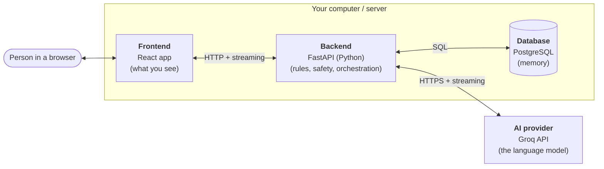
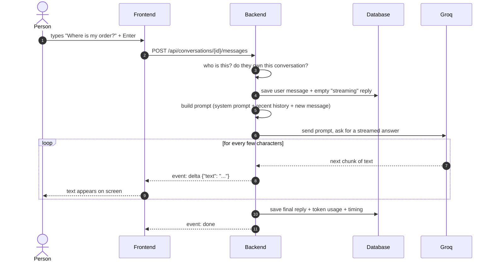
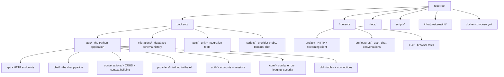
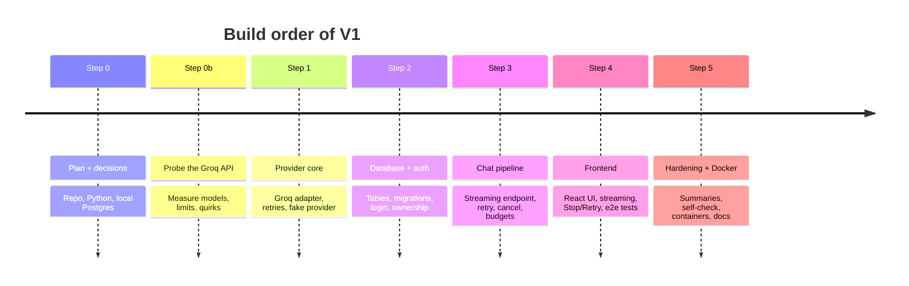

# 01 · The big picture

## What we built

A **customer-support chatbot web application**:
- A person opens a website, creates an account, and chats with an AI assistant.
- Replies appear word by word, conversations are saved, and each user only ever sees their own conversations.
- When something goes wrong (the AI service is busy, the network drops), the app says so clearly and offers **Retry**.

The AI itself is **not** running on your computer. We send the conversation over the internet to a hosted model (Groq's API) and stream its answer back. Everything else is our code: accounts, saving, safety, streaming, the user interface.

## The four parts

| Part | Job | Analogy | Lives in |
|---|---|---|---|
| **Frontend** | Shows the chat, sends what you type, displays the reply as it arrives | The shop counter | `frontend/` |
| **Backend** | Checks who you are, enforces rules, builds the prompt, talks to the AI, saves everything | The shop manager | `backend/` |
| **Database** | Remembers users, sessions, conversations, messages, usage | The filing cabinet | Docker container `db` |
| **AI provider** | Generates the text | An expert you phone for answers | Groq's servers |

**Why is the backend in the middle, instead of the browser talking to Groq directly?**
1. **Secrets:** the API key must never reach the browser, or anyone could steal it.
2. **Trust:** the browser is under the user's control. Rules such as "you may only read your own conversations" must be enforced somewhere the user can't tamper with.
3. **Memory:** conversations must be saved centrally.
4. **Control:** budgets, retries, rate limits and logging all need one place to live.

## The journey of one message (the 10-second version)

That is the whole idea. The rest of this guide explains each arrow in depth: what can go wrong at each step, and how the code handles it.

## How the folders map to the parts

Start your code exploration at these two entry points:
- **Backend:** [`main.py:28` `create_app`](../backend/app/main.py#L28) is where the server is assembled.
- **Frontend:** [`App.tsx` routes](../frontend/src/App.tsx#L87) is where the pages are wired together.

## The design principles behind every decision

These come from the roadmap (`docs/ROADMAP.md` §3, §41). You will see them over and over:

1. **Introduce technology only when it solves a concrete problem.** There's no LangChain, no Redis and no separate vector database. Each would add complexity without solving a V1 problem.
2. **Talk to AI providers with plain HTTP requests**, not their SDKs. You see exactly what is sent and received, and swapping providers is easy.
3. **Never trust the browser.** Every rule is enforced in the backend.
4. **Measure, don't assume.** Model limits, token counts and timings were *measured*, then the design followed (`docs/providers.md`).
5. **Every failure has a defined outcome.** The app never just hangs or shows a blank screen.
6. **Keep it runnable and tested at every step.** The project was built in five increments, each one working and tested.

## The build order (how it was actually built)

Why this order? Each layer only depends on the ones below it:
- You can't stream a chat (step 3) before you can talk to the AI (step 1) and save messages (step 2).
- You can't build the UI (step 4) before there is an API to call.

Chapter [14](14-rebuild-roadmap.md) turns this into a rebuild plan for you.

**Next:** [02 · Foundations and tooling →](02-foundations-and-tooling.md)
