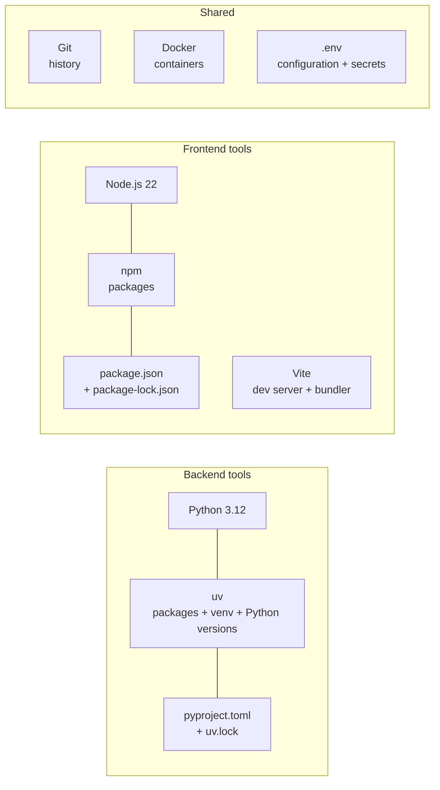
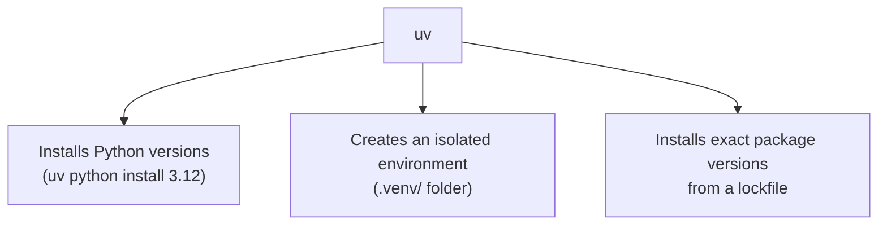
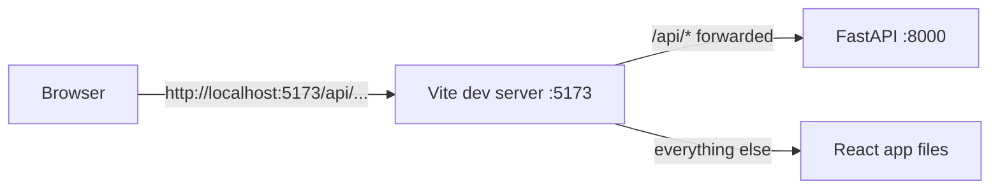
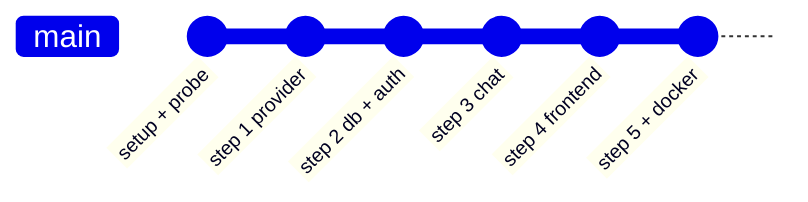
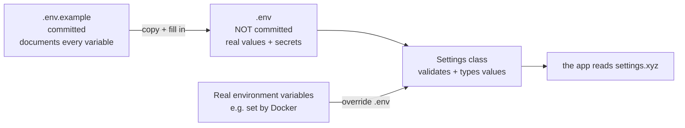
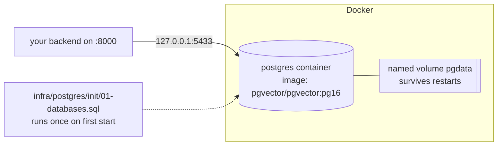

# 02 · Foundations and tooling

Before any feature, a project needs a **workshop**: languages, package managers, version control, configuration, and a database to develop against. This chapter explains each tool, *why it was chosen*, and where you see it in the repo.

## The toolbox at a glance

## Python and uv

**Python** runs the backend. Version **3.12** was chosen because the machine had 3.10, which reached end of life in October 2026 and no longer gets security fixes.

**uv** is a fast tool that does three jobs which used to need three separate tools:

### Two files work together

- [`backend/pyproject.toml`](../backend/pyproject.toml) states **what you want**, e.g. "FastAPI, at least version X". It also holds tool settings: pytest options, lint rules.
- [`backend/uv.lock`](../backend/uv.lock) records **exactly what was installed**: every package, including dependencies of dependencies, pinned to an exact version and checksum.

**Why a lockfile?** Without it, installing next month could pull newer versions and behave differently. With it, your machine, a teammate's machine and the Docker image all get *byte-identical* dependencies. The Docker build uses `--frozen`, which means "fail if the lock doesn't match" ([`Dockerfile:17`](../backend/Dockerfile#L17)).

### The virtual environment

`.venv/` is a private copy of Python plus packages, just for this project. Two projects needing different versions of the same library no longer conflict. It is in `.gitignore`: it's rebuilt from the lockfile, never committed.

### Dev dependencies vs runtime dependencies

pytest, respx (HTTP mocking) and ruff (linter/formatter) are **dev** dependencies: needed to develop and test, not to run. The production image skips them (`--no-dev`), which keeps it smaller.

### This machine's quirk

uv was installed through pip, so it is run as `python -m uv` instead of `uv` (it is not on PATH). The same commands work either way.

## Node.js, npm and Vite

The frontend is TypeScript/React, which browsers can't run directly. It has to be **compiled and bundled** into plain JavaScript.

| Tool | Role |
|---|---|
| **Node.js** | Runs JavaScript tooling on your machine (not in the browser) |
| **npm** | Installs packages listed in [`frontend/package.json`](../frontend/package.json) and locks them in `package-lock.json` (same idea as uv.lock) |
| **Vite** | **Dev mode:** serves the app with instant reload, and *proxies* API calls to the backend. **Build mode:** produces optimised static files in `dist/` |
| **TypeScript** | JavaScript plus types; catches mistakes before running (`npm run typecheck`) |
| **oxlint** | Finds suspicious code patterns (`npm run lint`) |

The **Vite proxy** is important; see [`vite.config.ts:14`](../frontend/vite.config.ts#L14) and [chapter 08](08-auth-and-security.md#why-same-origin-matters):

To the browser, everything comes from **one origin** (`localhost:5173`). That makes cookies and security checks simple: there is no cross-origin setup (CORS). In production, nginx plays the same role ([chapter 13](13-docker-and-operations.md)).

## Git: history and safety net

Each step of the build was one **commit**, so you can replay the project's evolution:

**Learning tip:** run `git log --stat` to see which files each step added, and `git show <commit>` to read one step in isolation. Reading the project commit by commit is the closest thing to watching it being built.

Two Git files matter:
- [`.gitignore`](../.gitignore) lists what must **never** be committed: `.env` (secrets), `.venv/`, `node_modules/`, test output, probe results (which contain an account ID).
- [`.gitattributes`](../.gitattributes) forces **LF line endings**. On Windows, Git may otherwise convert files to CRLF, and a shell script with CRLF endings breaks inside a Linux container: `/bin/sh^M: not found`. This one line prevents a nasty Docker bug.

## Configuration: environment variables and `.env`

Rule: **code is the same everywhere; configuration changes per environment.** Database address, API key, port and log level are *not* hard-coded.

- [`.env.example`](../.env.example) is the documented template. It's committed and contains **no real secrets**.
- `.env` holds your real values. It's git-ignored.
- [`config.py:15` `Settings`](../backend/app/core/config.py#L15) reads both, **validates** them (a port must be a number, the retry count must be 1–5…), and gives typed access. A typo or a missing value fails at startup with a clear message, not later in the middle of a request.

**Priority:** real environment variables beat `.env`. Docker uses this to override the database address inside containers ([chapter 13](13-docker-and-operations.md)).

**Secrets** such as `GROQ_API_KEY` are stored as a `SecretStr` type, which prints as `**********` if accidentally logged.

## The local database (Docker)

The backend needs PostgreSQL. Instead of installing it, we run it in a **container** (a lightweight isolated mini-computer) with Docker:

- **One container, three databases:** `assistant` (development), `assistant_test` (wiped by every pytest run) and `assistant_e2e` (browser tests). They're created by [`infra/postgres/init/01-databases.sql`](../infra/postgres/init/01-databases.sql), which Postgres runs only when the volume is new.
- **Port 5433, bound to 127.0.0.1:** it avoids clashing with any Postgres already on 5432, and nobody else on the network can reach it.
- **Why the pgvector image?** V2 (document search) needs vector similarity search. Using this image from day one means no migration later. ([`docs/decisions.md`](../docs/decisions.md) #2, #10.)
- **Why local instead of hosted (Supabase)?** It was planned as hosted, then switched: a hosted service needs manual account setup and pauses when idle, while a local container is one command and fully scriptable.

> 💡 **Use `127.0.0.1`, not `localhost`.** On this Windows machine `localhost` tries IPv6 first and wastes 2 seconds per connection. The test suite went from 109 s to 12.6 s after this one change. See [chapter 15](15-lessons-learned.md).

## Code quality tools

| Tool | Command | What it catches |
|---|---|---|
| **ruff check** | `python -m uv run ruff check .` | Unused imports, likely bugs, outdated syntax, import order |
| **ruff format** | `python -m uv run ruff format .` | Formatting, so code style is never debated |
| **tsc** | `npm run typecheck` | Type errors in the frontend |
| **oxlint** | `npm run lint` | React mistakes, e.g. reading refs during render |

Their rules live in [`pyproject.toml`](../backend/pyproject.toml) (the `[tool.ruff]` section).

## Recreating the workshop yourself (conceptually)

1. Create a folder, `git init`, and add `.gitignore` and `.gitattributes`.
2. Install uv, then `uv python install 3.12`.
3. `uv init` a backend project, and `uv add` dependencies as each step needs them. **Don't install everything up front.**
4. Write a `docker-compose.yml` containing only the database, and start it.
5. Create `.env.example`, copy it to `.env`, and fill in your key.
6. Later, scaffold the frontend with Vite's React + TypeScript template.

Exact steps with checkpoints are in [chapter 14](14-rebuild-roadmap.md).

**Next:** [03 · How LLM APIs work →](03-how-llm-apis-work.md)
