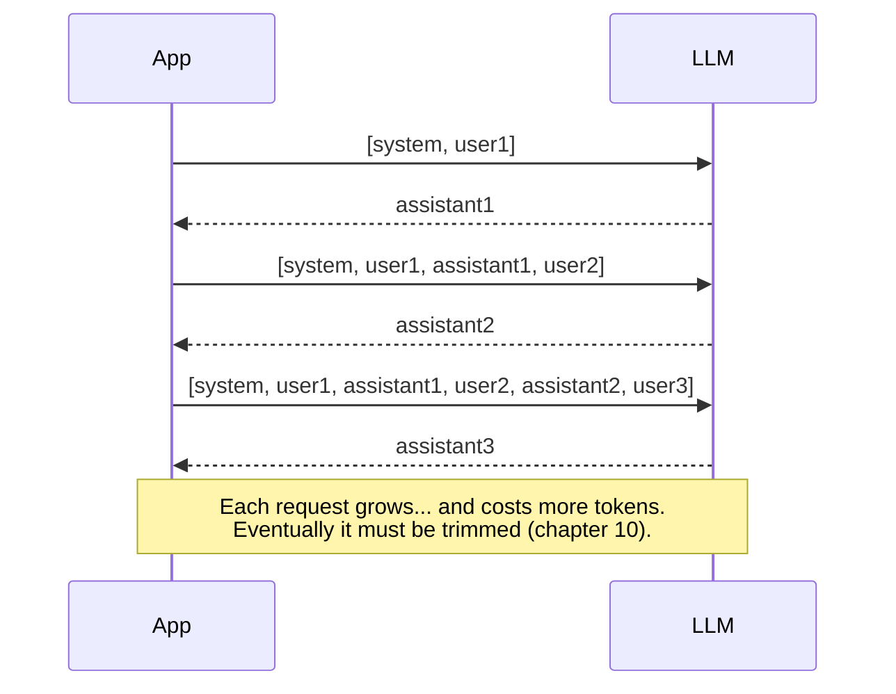
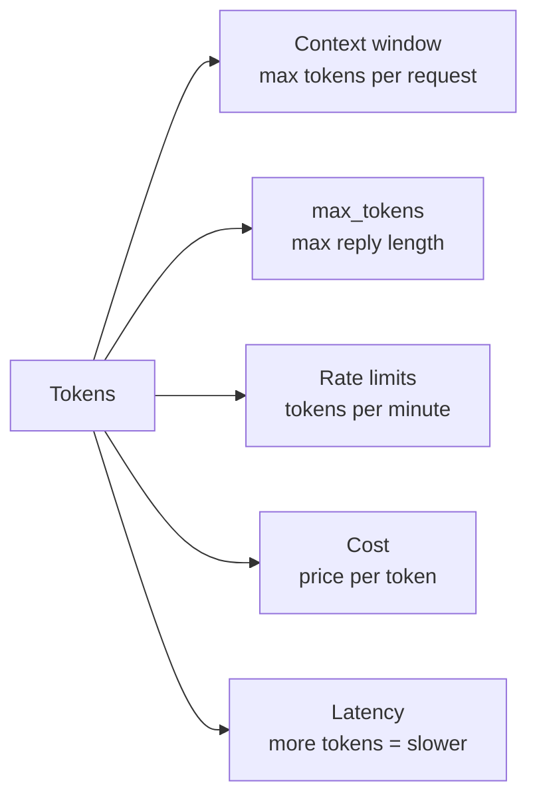
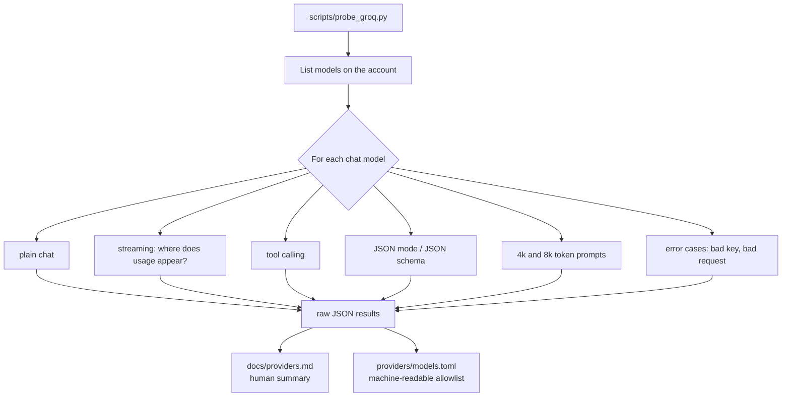

# 03 · How LLM APIs work

You can't build a good chatbot without understanding what you are actually sending to the model and what comes back. This chapter is the mental model.

## A language model has no memory

The single most important fact:

> **The model remembers nothing between requests.** Every request must contain the *entire* conversation you want it to consider.

"Chat history" is an illusion created by **you** re-sending previous messages each time:



This is why the app saves every message (chapter 07) and has a **context budget** (chapter 10).

## The chat request

Almost every provider uses the "chat completions" shape popularised by OpenAI. A generic example, not from our code:

```json
{
  "model": "some-model-id",
  "messages": [
    {"role": "system",    "content": "You are a helpful support agent."},
    {"role": "user",      "content": "Where is my order?"},
    {"role": "assistant", "content": "Could you share your order number?"},
    {"role": "user",      "content": "It's 1042."}
  ],
  "temperature": 0.3,
  "max_tokens": 800,
  "stream": true
}
```

| Field | Meaning |
|---|---|
| `role: system` | Instructions for the model's behaviour. The user doesn't see it. Our default support prompt is in [`config.py` `default_system_prompt`](../backend/app/core/config.py#L43). |
| `role: user` / `assistant` | The conversation so far, oldest first |
| `temperature` | Randomness. 0 is focused and repeatable; 1 and above is creative and varied. We default to 0.3 for support answers. |
| `max_tokens` | The **maximum length of the reply**. If it's reached, the reply is cut off and `finish_reason` is `"length"`. |
| `stream` | `true` means "send words as you generate them" ([chapter 04](04-streaming-and-sse.md)) |

Our code builds this payload in exactly one place: [`groq.py:232` `build_payload`](../backend/app/providers/groq.py#L232). It translates *our* internal request type into Groq's JSON.

## Tokens: the unit of everything

Models don't read characters or words. They read **tokens**, chunks of text of roughly 3–5 characters in English:

```
"Customer support"  →  ["Customer", " support"]          (2 tokens)
"unbelievable"      →  ["un", "believ", "able"]           (3 tokens)
```

Tokens matter because **everything is measured in them**:



After each request the provider reports **usage**: `prompt_tokens` (what you sent), `completion_tokens` (what it wrote) and `total_tokens`. We store these for every call in the `llm_calls` table ([chapter 07](07-database.md)).

## Rate limits: the real constraint

Providers limit how much you can use per minute. Our measured Groq free-tier limits (in [`docs/providers.md`](../docs/providers.md)):

| Limit | Value | Meaning |
|---|---|---|
| Requests per day/minute | ~1000 | rarely the problem |
| **Tokens per minute (TPM)** | **8000** | **the real ceiling** |
| Input tokens per minute (qwen) | 7000 | |

The models advertise a **131 072-token** context window, yet a single request over **8000** tokens fails with HTTP **413**, because the per-minute budget is smaller than the window. So *your account limits* matter more than the model's advertised size. That's why we use a context budget of **3000** input tokens plus **800** for the reply: about 4k per request, so a user can send about 2 messages a minute.

## Reasoning models

Some models (gpt-oss here) "think" before answering. They emit hidden **reasoning tokens** that:
- count against `max_tokens`: in testing, a 20-token limit produced an *empty* answer because the thinking used it all
- arrive in the stream as separate `reasoning` fields, which we **ignore** ([`groq.py:140`](../backend/app/providers/groq.py#L140))
- can be reduced with `reasoning_effort: "low"`, which we only send to models marked `reasoning = true`

## Probe first, trust later

The roadmap rule: **never assume** a model's capabilities or limits. Before writing the real adapter, a script called the API directly and recorded what actually happened:



- Script: [`backend/scripts/probe_groq.py`](../backend/scripts/probe_groq.py) (read `main()` at the bottom first).
- Results became [`docs/providers.md`](../docs/providers.md) and [`models.toml`](../backend/app/providers/models.toml).

**What the probe discovered, which no documentation told us:**
1. A request bigger than the TPM limit returns **413 with a `retry-after` header**, but retrying can *never* succeed. So 413 must not be retried.
2. Usage arrives in the **last stream chunk**, in two places (`usage` and `x_groq.usage`).
3. Reasoning models eat `max_tokens` on hidden thinking.
4. `allam-2-7b` has a 4096-token window and no tool support, so it was excluded.
5. Real TPM: 8000. That number drove the whole context-budget design.

> **Lesson:** a one-hour probe prevented several bugs that would otherwise have surfaced in production.

## The model registry

[`models.toml`](../backend/app/providers/models.toml) is the **allowlist**: only models listed there can be used, each with its *verified* capabilities. [`registry.py:47` `ModelRegistry`](../backend/app/providers/registry.py#L47) loads it and validates every field (via the `ModelInfo` Pydantic model at [`registry.py:19`](../backend/app/providers/registry.py#L19)). The frontend's model dropdown comes from `/api/models` ([`api/models.py:22`](../backend/app/api/models.py#L22)), so the UI can only offer what the backend permits.

## Plain HTTP instead of an SDK

The roadmap prefers raw HTTP calls (with the **HTTPX** library) over Groq's official Python SDK:

| With an SDK | With direct REST (our choice) |
|---|---|
| Hidden retries you don't control | Retry policy is ours and tested (chapter 05) |
| Provider-specific types leak into your code | Our own types; only one file knows about Groq |
| Switching providers means rewriting callers | Add one adapter file |
| Behaviour hidden inside the library | You see every byte sent and received |

Groq exposes an "OpenAI-compatible" endpoint, but compatible **doesn't mean identical**: the 413 behaviour and `x_groq.usage` are Groq-specific. That's another reason to keep the details isolated in one adapter.

**Next:** [04 · Streaming and SSE →](04-streaming-and-sse.md)
