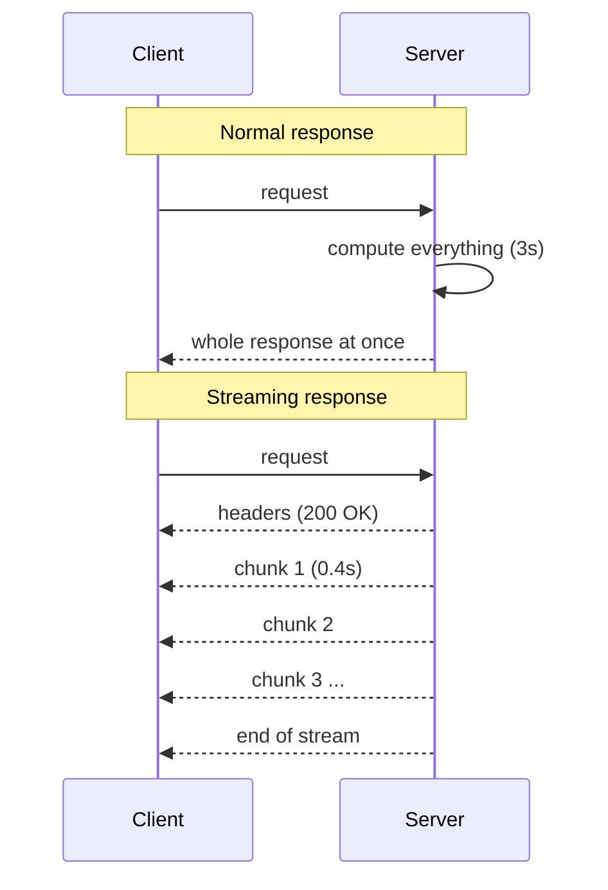
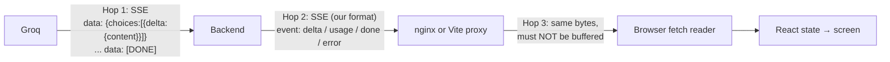
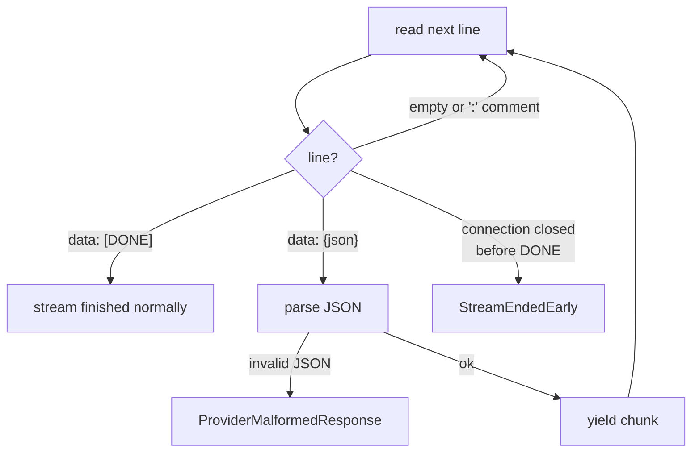
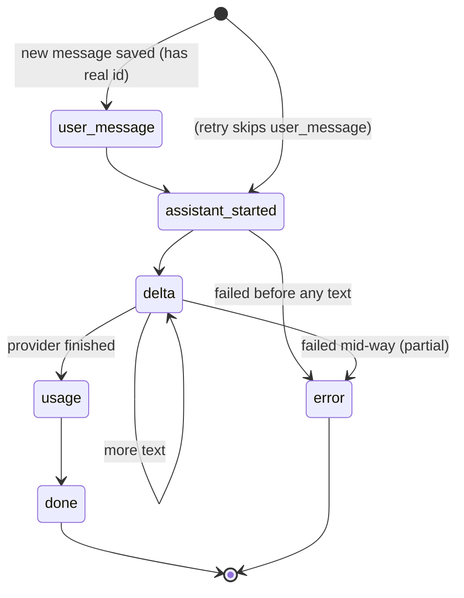
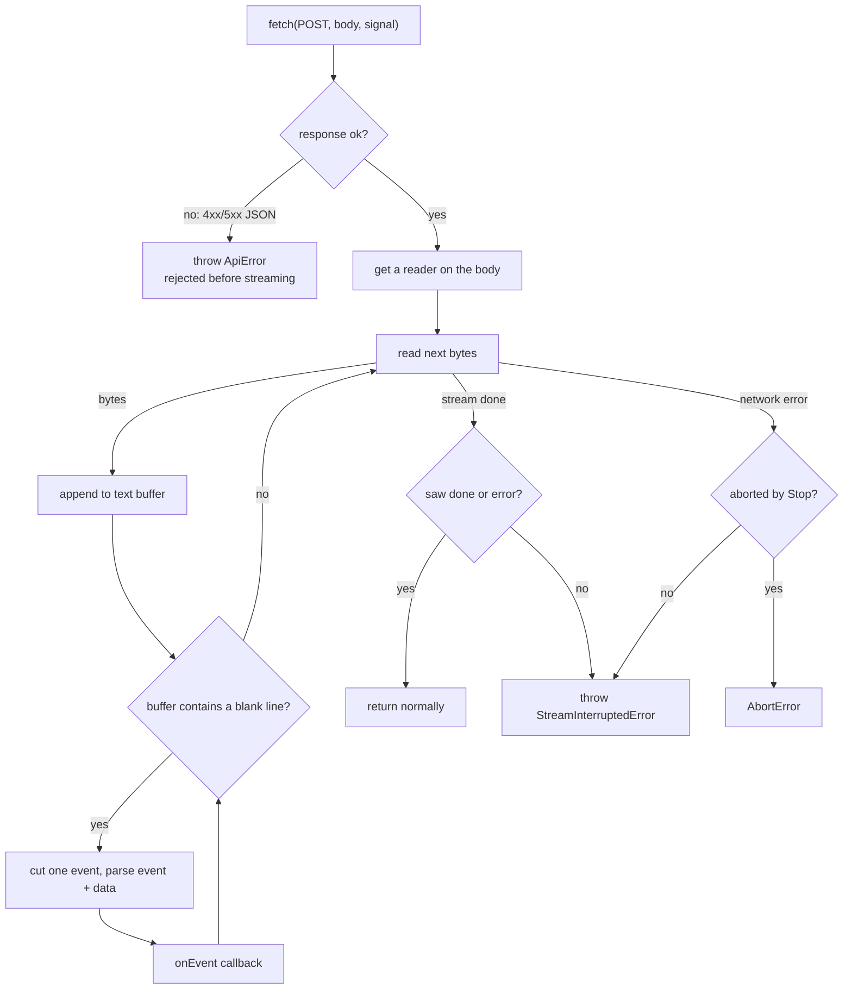
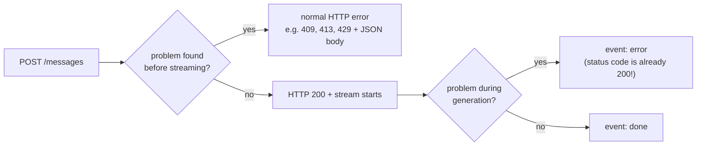

# 04 · Streaming and Server-Sent Events (SSE)

A 400-word reply can take 2–5 seconds to generate. Without streaming, the user stares at nothing, then everything appears at once. With streaming, the first words appear in about half a second. This chapter explains how words travel from Groq's servers to your screen, **one piece at a time**.

## Normal HTTP vs streaming HTTP



In streaming, the server sends the **headers first** and keeps the connection open, writing pieces of the body as they become ready.

## SSE: a tiny text format on top of streaming HTTP

**Server-Sent Events** gives those pieces a structure. It's plain text: each event is a few `field: value` lines followed by **a blank line**. A generic example:

```
event: delta
data: {"text": "Hello"}

event: delta
data: {"text": " there"}

event: done
data: {"status": "complete"}

```

Rules worth knowing:
- `data:` carries the payload; we always put JSON there.
- `event:` names the event type. It's optional; Groq doesn't use it, but our own API does.
- A blank line (`\n\n`) ends an event. Readers buffer text until they see one.
- Lines starting with `:` are comments, often used as keep-alives.
- The response header is `Content-Type: text/event-stream`.

**Why SSE and not WebSockets?**
- Our data flows **one way** (server → browser) per request, which is exactly SSE's job.
- WebSockets are two-way, need a different protocol and connection management, and are overkill here (`docs/decisions.md` #7).

## The three hops

A reply crosses **three streaming connections**. Each one has its own format and its own code:



### Hop 1: Groq → backend (reading someone else's stream)

Groq's format: each event is `data: {json}`, and the stream ends with the special line `data: [DONE]`.



- **The parser:** [`providers/sse.py:16` `iter_sse_json`](../backend/app/providers/sse.py#L16), a small async generator.
- **Reading content from each chunk:** [`groq.py:133`](../backend/app/providers/groq.py#L133) loops over chunks, takes `delta.content` ([`groq.py:140`](../backend/app/providers/groq.py#L140)) and picks up usage from the final chunk ([`groq.py:146`](../backend/app/providers/groq.py#L146)).

Note the **difference between "finished" and "ended"**: a stream that closes *without* `[DONE]` was cut off. We detect that, because a cut-off answer must not be saved as complete.

### Hop 2: backend → browser (writing our own stream)

Our API defines its own event vocabulary, documented in [`api/chat.py`](../backend/app/api/chat.py) (top docstring):



Each event exists so the frontend can do something specific:

| Event | Why the frontend needs it |
|---|---|
| `user_message` | Swap the temporary local id of your message for the real database id |
| `assistant_started` | Learn the reply's real id and model, and show the "typing" state |
| `delta` | Append text |
| `usage` | Token counts and timings (useful for debugging and analytics) |
| `done` | Mark the reply complete; `finish_reason: "length"` means it was cut off by `max_tokens` |
| `error` | A safe, human message, plus `retryable`, `retry_after` and the final status (`failed` / `partial`) |

Formatting one event is a one-liner: [`api/sse.py:30` `format_sse`](../backend/app/api/sse.py#L30).

### Hop 3: through the proxy without buffering

Proxies like nginx **buffer** responses by default: they collect the whole body and then forward it. That silently destroys streaming. Every word would arrive at the end. The fix is in [`nginx.conf:29`](../frontend/nginx.conf#L29) (`proxy_buffering off`), plus a long read timeout ([`nginx.conf:31`](../frontend/nginx.conf#L31)) so long generations aren't killed.

This was verified by measuring: 101 events arrived spread over 218 ms rather than all at once ([chapter 13](13-docker-and-operations.md)).

## Reading the stream in the browser

The browser has a built-in `EventSource` for SSE, but it **only supports GET**, and we need **POST** (to send the message body). So the frontend reads the stream manually with `fetch`:



Code: [`frontend/src/api/sse.ts:19` `postSSE`](../frontend/src/api/sse.ts#L19). Look at:
- the "rejected before streaming" branch: [`sse.ts:38`](../frontend/src/api/sse.ts#L38)
- the buffer splitting loop, around line 49
- the "no terminal event means interrupted" rule: [`sse.ts:65`](../frontend/src/api/sse.ts#L65)

**Important subtlety:** chunks from the network do **not** line up with events. One network chunk may hold half an event or three events. That's why the reader keeps a buffer and only cuts at blank lines.

## Two kinds of errors



Once the `200 OK` headers are sent they can't be changed. So any failure *during* streaming has to be expressed **inside** the stream, as an `error` event. Failures detected *before* streaming (bad input, not your conversation, duplicate, rate limit) use proper HTTP status codes. The frontend handles both ([chapter 11](11-frontend.md)).

## Cancelling a stream

When the user presses **Stop**, the frontend aborts the `fetch` with an `AbortController`. The connection closes, and the backend must notice this and stop asking Groq for more text (which would waste quota). Detecting that disconnect turned out to be subtle; the full story is in [chapter 09](09-chat-pipeline.md#cancellation-the-tricky-part).

**Next:** [05 · The provider layer →](05-provider-layer.md)
