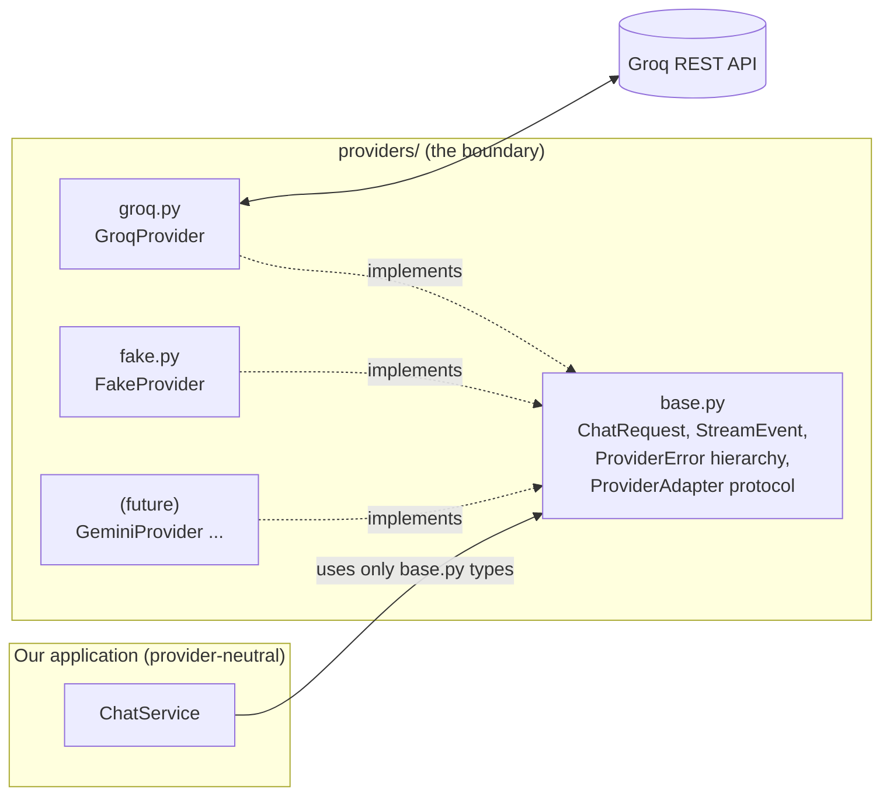
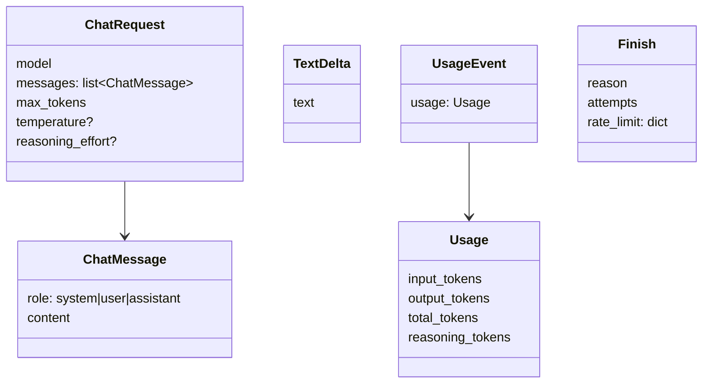
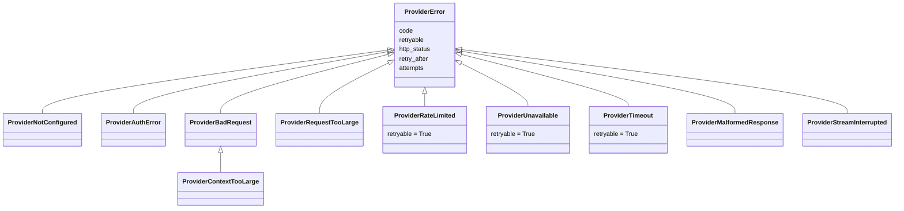
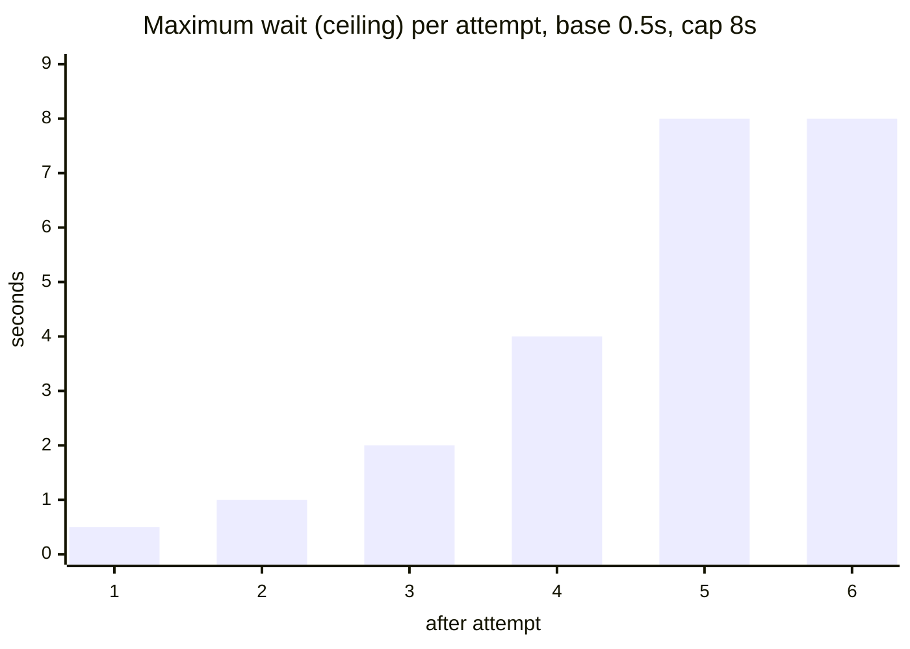
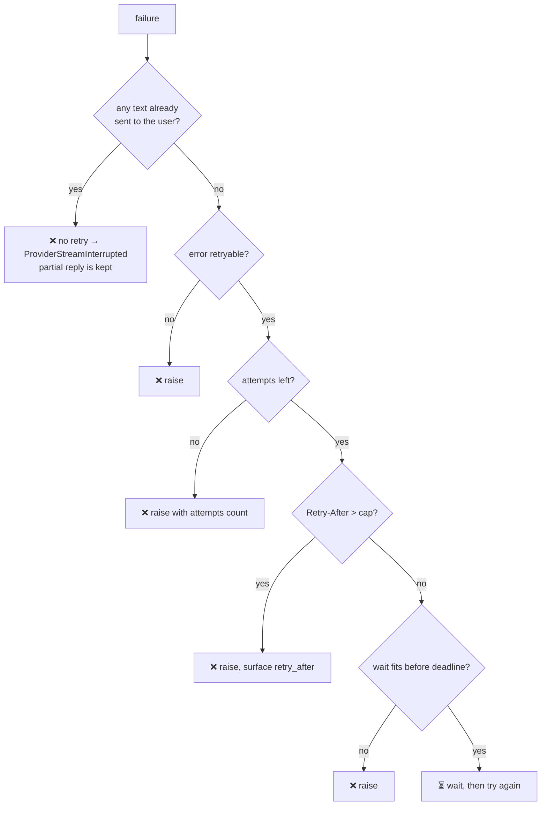
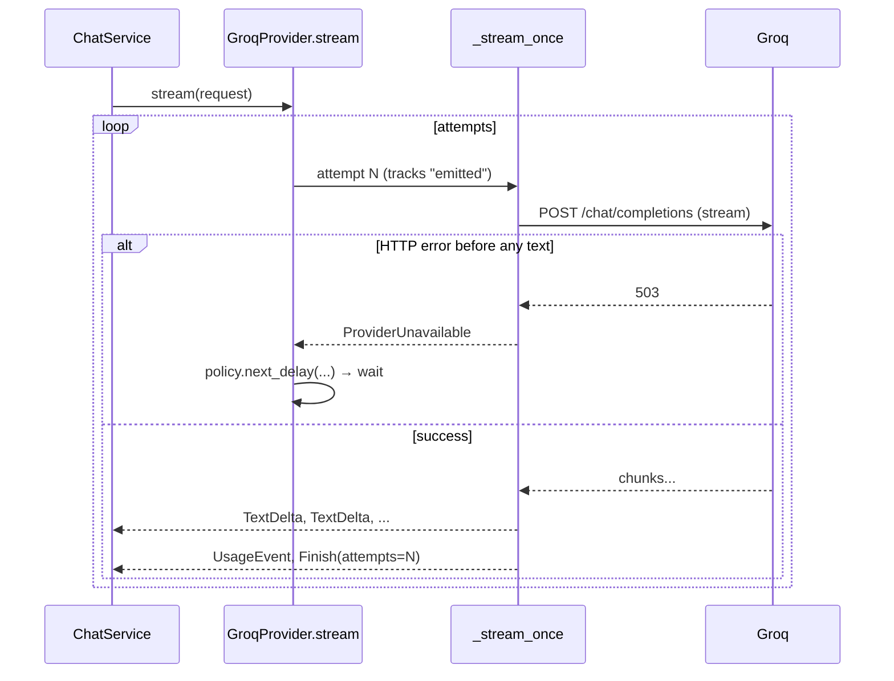
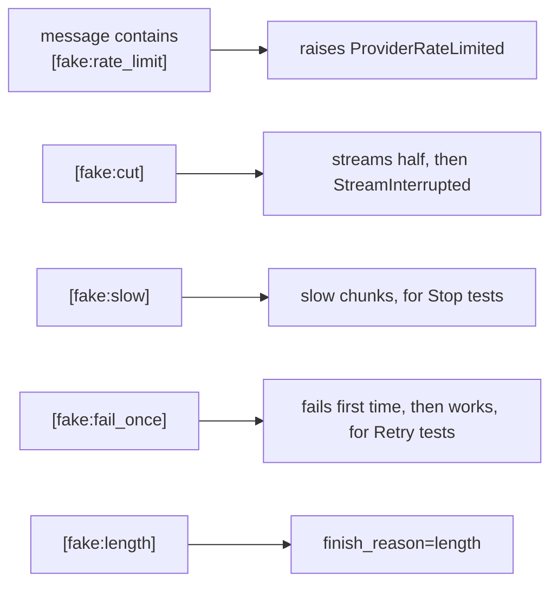

# 05 · The provider layer

The provider layer is the **only** part of the backend that knows Groq exists. Everything else speaks a small, neutral language. This chapter covers that boundary, how failures are classified, and the retry policy.

All files are in [`backend/app/providers/`](../backend/app/providers/).

## The adapter pattern



An **adapter** translates between your language and someone else's. `ChatService` asks for "a stream of events for this `ChatRequest`" and never sees JSON, URLs or HTTP status codes.

The contract is the `ProviderAdapter` **Protocol** in [`base.py:162`](../backend/app/providers/base.py#L162). A Protocol says "any object with these methods qualifies", without forcing inheritance:

| Method | Returns |
|---|---|
| `stream(request)` | An async iterator of events: `TextDelta`*, optional `UsageEvent`, then exactly one `Finish` |
| `complete(request)` | One `ChatResult` (non-streaming; used by summaries and the self-check) |
| `aclose()` | Releases the HTTP connection pool |

## Neutral data types



See [`base.py:20-75`](../backend/app/providers/base.py#L20). They are **frozen dataclasses**: immutable, so no code can accidentally modify a request halfway through.

## Classifying failures (the error hierarchy)

A provider can fail in many ways. The key question for each failure: **should we try again?**



Defined in [`base.py:78-160`](../backend/app/providers/base.py#L78). How raw HTTP responses map onto them, in [`groq.py:280` `error_from_response`](../backend/app/providers/groq.py#L280):

| What happened | Error | Retry? | Why |
|---|---|---|---|
| 401/403 | `ProviderAuthError` | ❌ | A wrong key stays wrong |
| 400/404/422 | `ProviderBadRequest` | ❌ | The same request fails the same way |
| 400 "reduce the length" | `ProviderContextTooLarge` | ❌ | Too long is too long |
| **413** | `ProviderRequestTooLarge` | ❌ | Bigger than the per-minute limit, so it *can never* fit (discovered by the probe) |
| 429 | `ProviderRateLimited` | ✅ | Wait and it frees up |
| 5xx, 408, 498 | `ProviderUnavailable` | ✅ | Temporary server trouble |
| Network timeout | `ProviderTimeout` | ✅ | Often transient |
| Connection dropped | `ProviderUnavailable` | ✅ | Often transient |
| Invalid JSON | `ProviderMalformedResponse` | ❌ | Retrying would waste quota |
| Broke **after** text was sent | `ProviderStreamInterrupted` | ❌ **never** | See below |

Each error carries a stable `code` (like `provider_rate_limited`). The rest of the app, and the frontend, rely on these codes, never on provider wording.

## The retry policy

Retrying sounds simple ("try again on failure") but naive retries cause real damage: hammering an overloaded server, waiting forever, or worse, **duplicating output**. The policy lives in one small, pure, well-tested class: [`retry.py:20` `RetryPolicy`](../backend/app/providers/retry.py#L20).

### Rule 1: bounded attempts

At most `max_attempts` (default 3). Never infinite.

### Rule 2: exponential backoff with full jitter

Wait longer after each failure, and **randomise** the wait:



The actual wait is a **random value between 0 and the ceiling** ("full jitter"). Why random? If 100 clients fail at the same moment and all wait exactly 1 s, they all retry at the same moment and overload the server again (the "thundering herd"). Randomness spreads them out.

A generic illustration of the formula (not our code):

```
ceiling = min(cap, base * 2^(attempt-1))
wait    = random_between(0, ceiling)
```

Ours: [`retry.py:25` `backoff`](../backend/app/providers/retry.py#L25).

### Rule 3: respect `Retry-After`, but don't make users wait forever

If the server says "retry after 3 s", wait at least 3 s. If it says "retry after 30 s", **give up immediately** and pass the 30 to the user ("try again in 30 s"), rather than holding their request open ([`retry.py:42`](../backend/app/providers/retry.py#L42)).

### Rule 4: an overall deadline

All attempts together must finish within 120 s. Never start a wait that would cross the deadline ([`retry.py:47`](../backend/app/providers/retry.py#L47)).

### Rule 5: never retry after output has been sent



**Why rule 5 matters:** suppose "Hello, your order" was streamed and then the connection dropped. A silent retry would produce a *different* answer, and the user would see "Hello, your orderThank you for contacting us…". Garbage. So once text has been emitted, a failure becomes a **partial** reply that the user can explicitly retry. The whole decision tree is one method: [`retry.py:30` `next_delay`](../backend/app/providers/retry.py#L30).

## How the Groq adapter uses the policy



- The outer loop is [`groq.py:80` `stream`](../backend/app/providers/groq.py#L80).
- One attempt is [`groq.py:119` `_stream_once`](../backend/app/providers/groq.py#L119).

Notice how low-level network errors are translated into our error types ([`groq.py:151-160`](../backend/app/providers/groq.py#L151)), and how `_interrupted_or` turns *any* failure into `ProviderStreamInterrupted` once text has gone out ([`groq.py:200`](../backend/app/providers/groq.py#L200)).

**Timeouts are layered:**
- **connect** 5 s: can we reach the server at all?
- **read** 30 s: the maximum silence between chunks
- **total** 120 s: the overall deadline, checked between chunks

**Testability trick:** the adapter accepts `sleep` and `clock` functions in its constructor ([`groq.py:49`](../backend/app/providers/groq.py#L49)). Tests pass fakes, so "wait 8 seconds" takes 0 seconds, and a "deadline in 1 second" can be simulated deterministically.

## The fake provider

[`fake.py:56` `FakeProvider`](../backend/app/providers/fake.py#L56) implements the same protocol without any network. It echoes the user's message ("(fake reply) You said: …") and can be told to misbehave with **markers inside the message text**:



The full list is in the file's docstring. Why markers? The **browser tests** can't reach into the server's memory to inject a failure, but they *can* type a message. So the trigger lives in the message text.

It makes possible:
- tests that are **fast, free, deterministic and offline**
- e2e browser tests with no API key
- demos with `PROVIDER=fake` (the setup script offers this if you have no key)

## Choosing the provider at startup

[`registry.py:70` `build_provider`](../backend/app/providers/registry.py#L70) reads the settings:
- `PROVIDER=fake` gives a `FakeProvider`.
- `PROVIDER=groq` with a key gives a `GroqProvider`, built with the timeouts and retry settings from config.
- `PROVIDER=groq` **without** a key gives `None`. The app still starts, but `/health/ready` reports `provider_not_configured`, and chat returns a clear 503 instead of crashing.

## Exercise
Read [`backend/tests/unit/test_groq_provider.py`](../backend/tests/unit/test_groq_provider.py). Each test name is a sentence describing one rule above. Pick one, predict what the code does, then trace it through `groq.py` and `retry.py`.

**Next:** [06 · Backend skeleton →](06-backend-skeleton.md)
