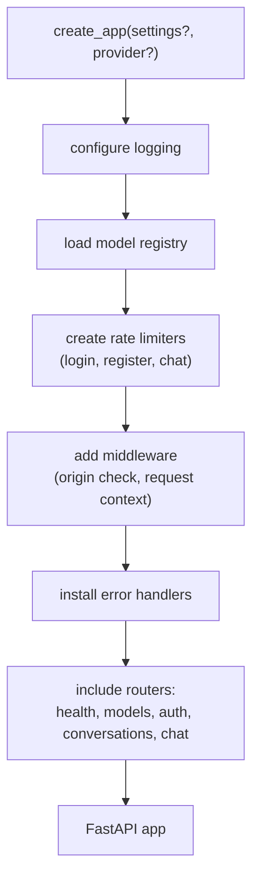
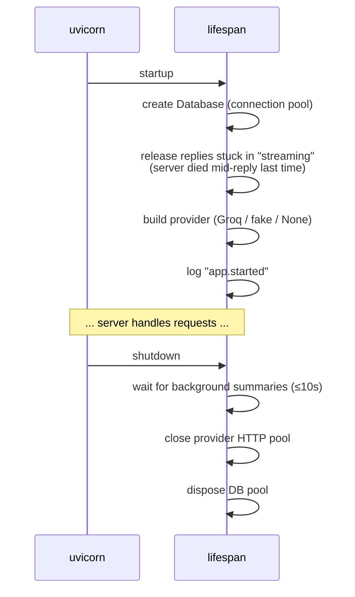
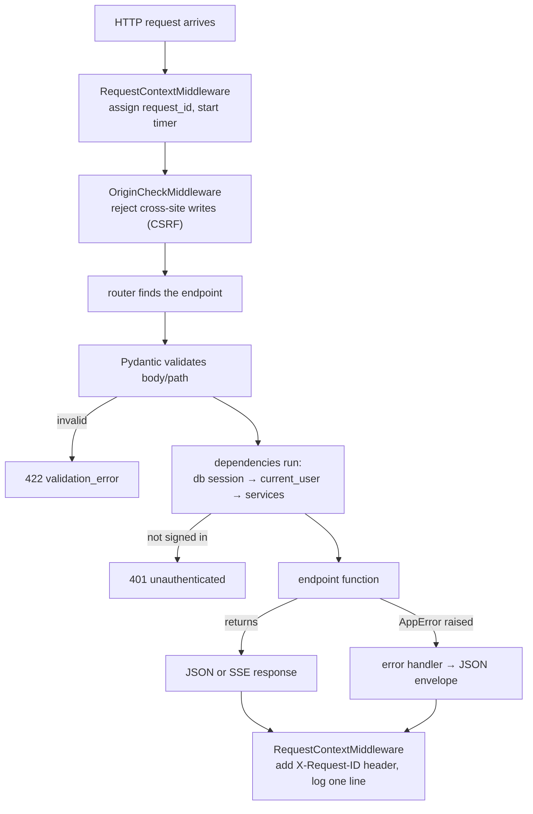
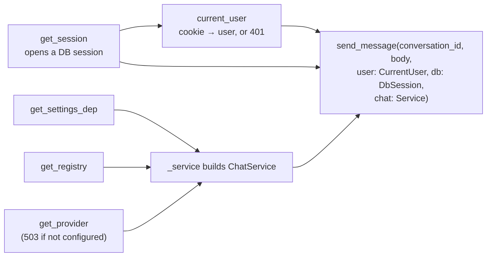
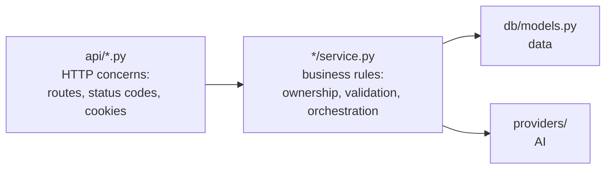
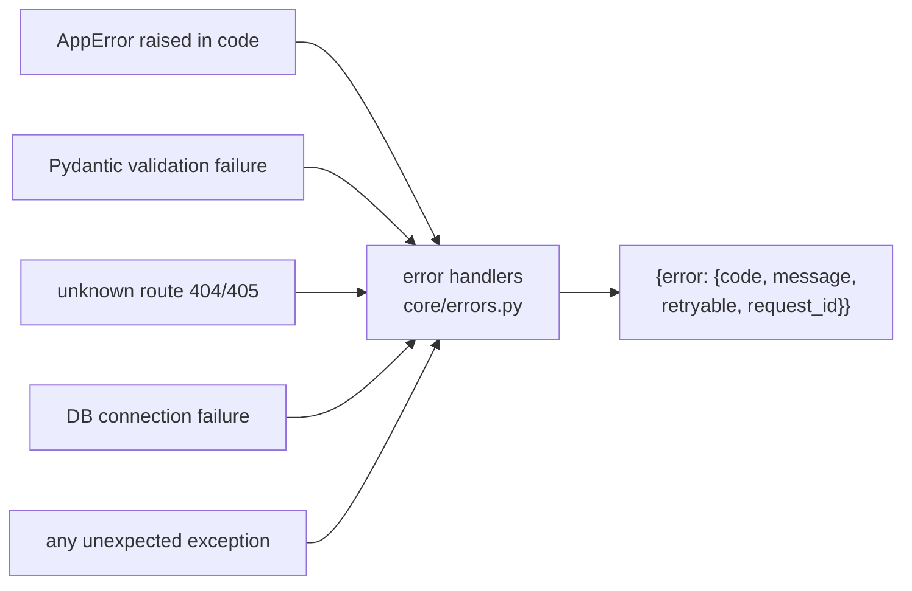
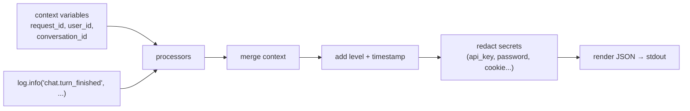

# 06 · Backend skeleton (FastAPI)

This chapter covers the *frame* every feature hangs on: how the web server is assembled, how a request flows through it, how errors and logs are shaped, and how configuration reaches the code.

## FastAPI in one paragraph

**FastAPI** is a Python web framework. You write ordinary async functions, decorate them with a route ("POST /api/auth/login"), and declare their inputs with type hints. FastAPI then:
1. parses and **validates** the incoming JSON against Pydantic models
2. injects **dependencies** (database session, current user…)
3. calls your function and serialises its result to JSON
4. generates interactive docs at `/docs`

It runs on **uvicorn**, an ASGI server: the program that actually listens on the network port.

## The app factory

Instead of one global `app = FastAPI()` configured at import time, the app is built by a function: [`main.py:28` `create_app(settings, provider)`](../backend/app/main.py#L28).



**Why a factory?** Tests can build *fresh, isolated apps* with different settings ("rate limit of 2", "database is down", "fake provider") without restarting anything. You'll see this everywhere in [chapter 12](12-testing.md).

## Lifespan: startup and shutdown

Some things must happen **once** when the server starts, and be cleaned up when it stops. FastAPI's `lifespan` handles this ([`main.py:34`](../backend/app/main.py#L34)):



Shared objects are stored on `app.state` (`app.state.db`, `app.state.provider`, `app.state.registry`…), and request handlers reach them through dependencies.

## The life of one request



### Middleware

Middleware wraps *every* request. We have two, both written as **pure ASGI** classes rather than with the simpler `BaseHTTPMiddleware` helper. That helper can interfere with streaming responses, and streaming is the core of this app.

1. **[`middleware.py:19` `RequestContextMiddleware`](../backend/app/core/middleware.py#L19)**
   - gives each request an ID: it reuses a valid incoming `X-Request-ID` or generates one ([`middleware.py:28`](../backend/app/core/middleware.py#L28))
   - binds the ID to the logging context, so *every* log line from this request carries it
   - adds the ID to the response headers
   - writes one access-log line, except for successful health checks, which would flood the logs ([`middleware.py:49`](../backend/app/core/middleware.py#L49))
2. **[`csrf.py:20` `OriginCheckMiddleware`](../backend/app/core/csrf.py#L20)** is covered in [chapter 08](08-auth-and-security.md).

**Order matters.** The middleware added last runs *outermost*. Request context is added last ([`main.py:68-69`](../backend/app/main.py#L68)), so even CSRF rejections get a request ID.

### Dependency injection

Instead of each endpoint fetching what it needs, it *declares* what it needs, and FastAPI provides it:



All shared dependencies live in [`api/deps.py`](../backend/app/api/deps.py). The aliases at the bottom (`CurrentUser`, `DbSession`, `Registry`, `AppSettings`) keep endpoint signatures readable.

**Security payoff:** an endpoint that declares `user: CurrentUser` *cannot run* for an anonymous request, because the dependency raises 401 first. Authentication is enforced by the function signature itself.

### Endpoints are thin

Look at any file in [`app/api/`](../backend/app/api/): each endpoint is a few lines. It binds log context, checks a rate limit, calls a **service** function, and returns. The real logic lives in services:
- `auth/service.py`
- `conversations/service.py`
- `chat/service.py`



**Why separate them?** Services can be tested and reused without HTTP (the self-check and the tests call them directly), and each layer has one reason to change.

## Pydantic schemas: the API contract

Request and response shapes are Pydantic models in [`app/schemas/`](../backend/app/schemas/):
- [`Credentials`](../backend/app/schemas/auth.py#L9): email must be a valid address, password 8–128 characters
- [`ConversationCreate`](../backend/app/schemas/conversations.py#L25): blank strings become `None`, and the system prompt is at most 4000 characters
- [`SendMessageIn`](../backend/app/schemas/chat.py#L12): `client_message_id` must be a UUID (for idempotency, [chapter 09](09-chat-pipeline.md))

**Responses** also go through schemas (`UserOut`, `ConversationOut`, `MessageOut`). This means a field such as `password_hash` **can never leak**: it simply isn't in `UserOut`.

## One error format everywhere

Every error, whatever its cause, has the same JSON shape:

```json
{"error": {"code": "not_found", "message": "Conversation not found.", "retryable": false, "request_id": "3dfc8f..."}}
```



- `AppError` ([`errors.py:22`](../backend/app/core/errors.py#L22)) is the exception our code raises on purpose: a code, a human message, an HTTP status, retryable or not, optional headers and details.
- [`install_error_handlers`](../backend/app/core/errors.py#L57) maps every kind of failure onto the envelope:
  - Database connection problems become **503 `db_unavailable`**, marked retryable.
  - Unexpected crashes become **500 `internal_error`**. The real exception is **logged** but **never shown**, so internal details can't leak.

**Why it matters:**
- The frontend handles errors with one function.
- Users can quote the `request_id` to support staff.
- You can then find every log line for that exact request.

## Structured logging

Logs are **JSON lines**, not free text, via `structlog` ([`core/logging.py`](../backend/app/core/logging.py)):

```json
{"event": "chat.turn_finished", "status": "complete", "input_tokens": 126, "ttft_ms": 324, "request_id": "...", "user_id": "...", "conversation_id": "...", "level": "info", "timestamp": "..."}
```



- **Context variables** are set once (in middleware and in `current_user`) and then appear on every line automatically.
- **Redaction** ([`logging.py:21`](../backend/app/core/logging.py#L21)) replaces sensitive keys with `[REDACTED]`, as a safety net.
- **Message text is not logged** unless `LOG_CONTENT=true`, which protects customer privacy.
- Machine-readable logs can later feed dashboards (V6).

## Configuration in code

[`config.py:15` `Settings`](../backend/app/core/config.py#L15) is a Pydantic `BaseSettings`: each field is an environment variable with a type, a default and limits (for example `Field(ge=1, le=5)`). `get_settings()` is cached, so settings are read once. Tests bypass the cache by passing `Settings(_env_file=None, ...)` straight to `create_app`.

## Health endpoints

[`api/health.py`](../backend/app/api/health.py) has two endpoints:

| Endpoint | Question it answers | Used by |
|---|---|---|
| `/health/live` | Is the process running? | Docker restarts the container if this fails |
| `/health/ready` | Can it do useful work? (DB reachable? provider configured?) | Humans, scripts and orchestrators; returns 503 with details otherwise |

Keeping them separate matters: a missing API key should make the app *not ready*, but restarting it wouldn't fix anything, so it must still be *live*.

## Exercise
Start the backend locally and open http://localhost:8000/docs. Call `/health/ready`, then register via the docs UI and watch the terminal: find your `request_id` in the response headers and in the log line.

**Next:** [07 · The database →](07-database.md)
