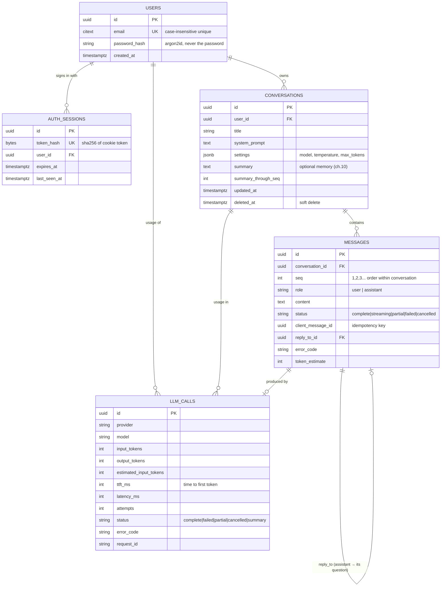
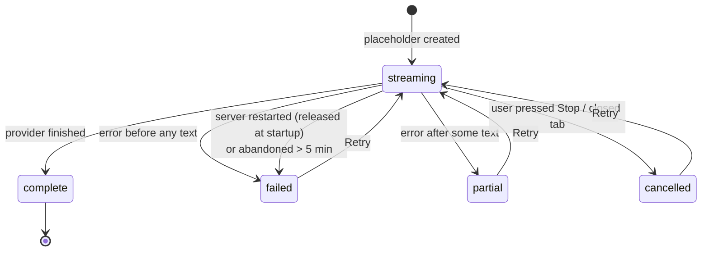
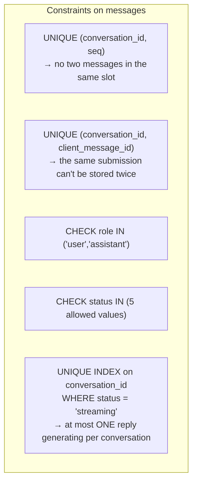
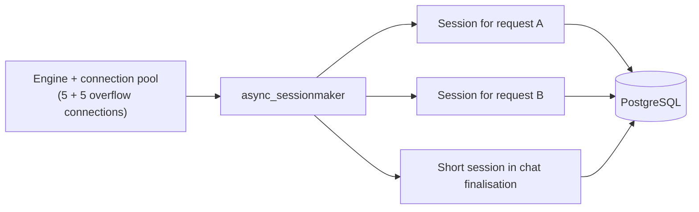
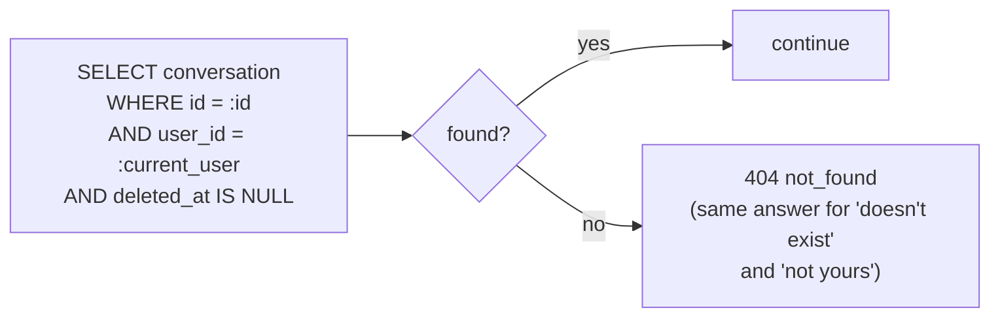
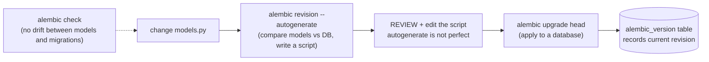

# 07 · The database

The database is the app's memory, and also its **last line of defence**: several important rules are enforced by the database itself, so even buggy code can't break them.

## Why PostgreSQL

- A reliable relational database: tables, relationships, transactions.
- **pgvector** will add vector search in V2, so documents can sit next to everything else instead of in a separate vector database.
- Rich types: `UUID`, `JSONB` (flexible JSON), `citext` (case-insensitive text), and partial indexes.

## The schema



Defined in [`db/models.py`](../backend/app/db/models.py). Read these classes in order: `User` (line 41), `AuthSession` (50), `Conversation` (64), `Message` (83), `LlmCall` (117).

### Design choices worth understanding

| Choice | Why |
|---|---|
| **UUID primary keys** | Unguessable (you can't probe `/conversations/1`, `/2`…), and they can be created in code before saving |
| **`seq` per conversation** | Timestamps can tie or drift; an integer sequence gives a *guaranteed* order |
| **Message `status`** | A reply is a *process*, not just text: it can be streaming, complete, failed, partial or cancelled. The UI and retry logic depend on this. |
| **`settings` as JSONB** | Model settings may grow; JSON avoids a migration for each new field |
| **Soft delete (`deleted_at`)** | Deleting hides the conversation; data can be recovered and usage history stays intact |
| **`llm_calls` separate from messages** | One message can involve several attempts, and summaries are calls without a message. Accounting is its own concern. |
| **Session token stored as a hash** | If the database leaks, the stolen hashes can't be used as cookies ([chapter 08](08-auth-and-security.md)) |

## The message lifecycle (status as a state machine)



A reply row is created **before** generation starts (as `streaming`) and is always moved to a final state afterwards, even when things go wrong ([chapter 09](09-chat-pipeline.md)).

## Rules the database enforces



See [`models.py:86-97`](../backend/app/db/models.py#L86) and the migration [`5d556bbaae89_initial_schema.py:121`](../backend/migrations/versions/5d556bbaae89_initial_schema.py#L121).

**C5 is a *partial unique index*:**
- It's unique only among rows that match a condition. Many complete replies per conversation are fine, but only one `streaming` row may exist at a time.
- Even if two requests race past the application checks at the same instant, the database rejects the second.
- The app turns that rejection into a friendly 409 ([chapter 09](09-chat-pipeline.md#concurrency-and-duplicates)).

> **Principle:** application checks give friendly errors; database constraints give *guarantees*. Use both.

## SQLAlchemy (async)

**SQLAlchemy** maps Python classes to tables and builds SQL for you. We use its **async** mode with the **asyncpg** driver, so the server can handle other requests while waiting on the database.



- [`db/session.py:15` `Database`](../backend/app/db/session.py#L15) creates the engine:
  - `pool_pre_ping` checks a pooled connection still works before using it.
  - a connect timeout makes a dead database fail fast.
- [`get_session`](../backend/app/db/session.py#L37) gives each request its own session, closed automatically afterwards.
- `expire_on_commit=False` keeps objects readable after commit. That's needed because we return them in responses after committing.

### A query pattern you'll see everywhere

Every conversation query includes **both** the id and the owner:



That's [`conversations/service.py:68` `get_owned`](../backend/app/conversations/service.py#L68). There is **no code path** that loads a conversation by id alone.

### Transactions and row locks

A **transaction** groups changes so they all happen or none do. `SELECT … FOR UPDATE` additionally **locks** a row until the transaction ends, so other transactions wanting the same lock wait their turn.

When a message is sent, the conversation row is locked ([`chat/service.py:132`](../backend/app/chat/service.py#L132)). Two simultaneous sends to the same conversation then run one after another: the second sees the first one's `streaming` row and gets "a reply is still being generated". [Chapter 09](09-chat-pipeline.md) shows the full sequence.

## Migrations (Alembic)

The schema changes over time. **Alembic** keeps a versioned history of changes, like Git for your database structure:



- Config: [`alembic.ini`](../backend/alembic.ini) and [`migrations/env.py`](../backend/migrations/env.py). The URL comes from app settings, so there's one source of truth.
- The first (and only, in V1) migration: [`5d556bbaae89_initial_schema.py`](../backend/migrations/versions/5d556bbaae89_initial_schema.py).
- **Manual edits** made to the autogenerated script:
  - `CREATE EXTENSION citext` (line 25), because autogenerate doesn't create extensions
  - the partial unique index

**Where migrations run:**

| Situation | Who runs `upgrade head` |
|---|---|
| Local development | You, manually |
| Tests | The test fixture, on a freshly wiped schema ([chapter 12](12-testing.md)), so the migration itself is tested on every run |
| Docker | The container's entrypoint, before starting the server ([`docker-entrypoint.sh:31`](../backend/docker-entrypoint.sh#L31)) |
| Self-check | `doctor` compares the DB's revision with the code's ([chapter 13](13-docker-and-operations.md)) |

## The usage ledger: `llm_calls`

Every AI call writes one row: success, failure, cancellation or background summary. This answers questions like:
- How many tokens did user X use today?
- What is our typical time to first token?
- How often does the provider fail?
- How accurate is our token *estimate* compared with the *real* count? This comparison is how the estimator was calibrated ([chapter 10](10-context-and-memory.md)).

Written in [`chat/service.py:534` `_finalise`](../backend/app/chat/service.py#L534).

## Exercise
```sh
docker exec -it ai-assistant-db-1 psql -U assistant -d assistant
\d messages          -- see constraints and indexes
SELECT seq, role, status, left(content, 40) FROM messages ORDER BY created_at DESC LIMIT 10;
SELECT status, count(*), avg(ttft_ms) FROM llm_calls GROUP BY status;
```

**Next:** [08 · Authentication and security →](08-auth-and-security.md)
