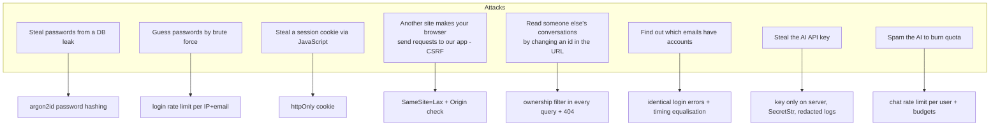
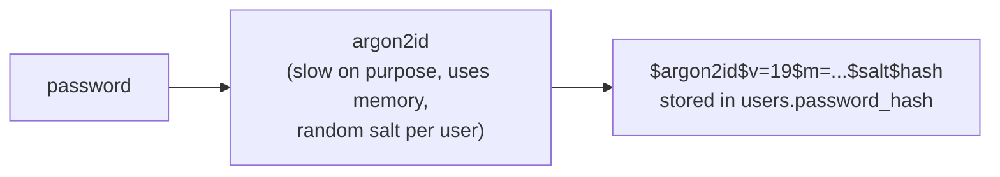
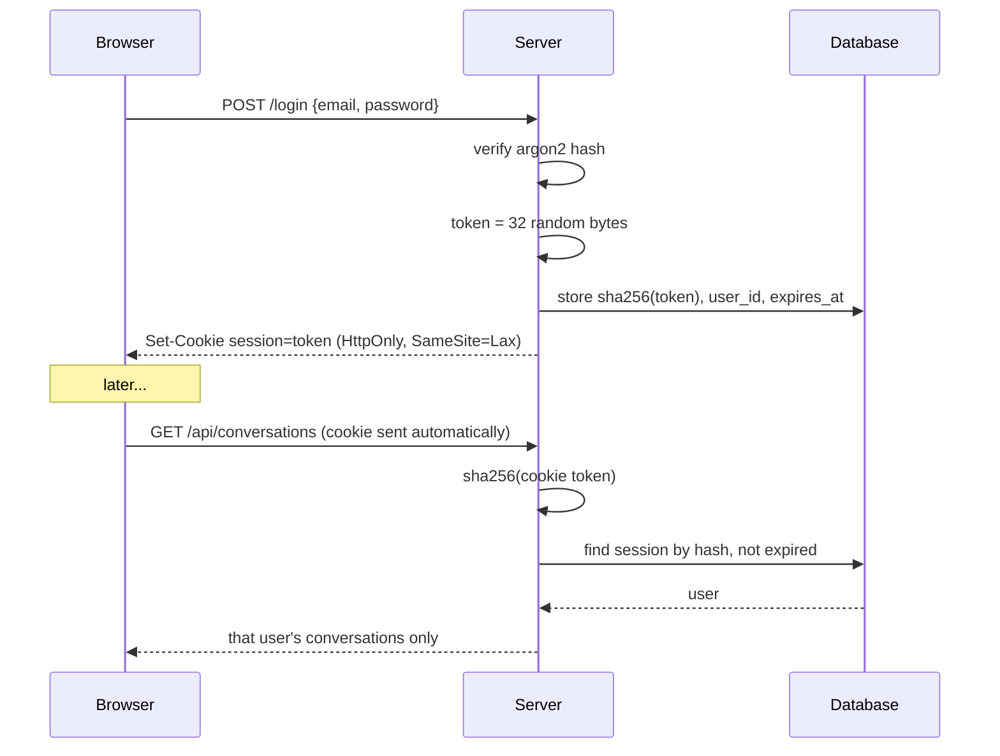
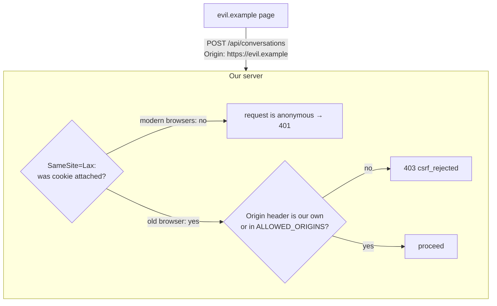
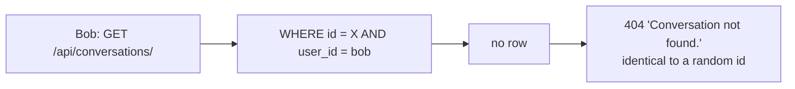
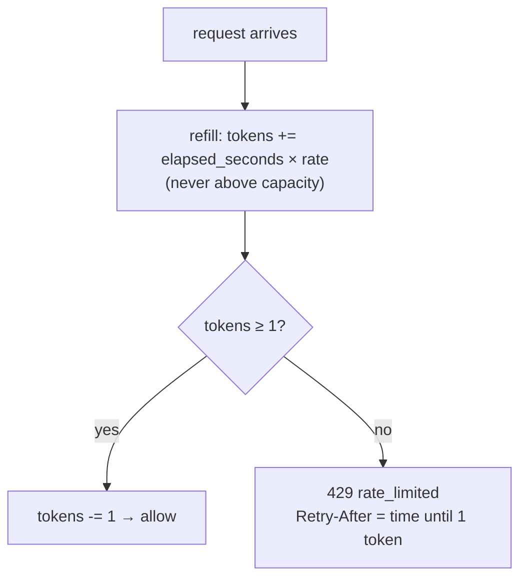
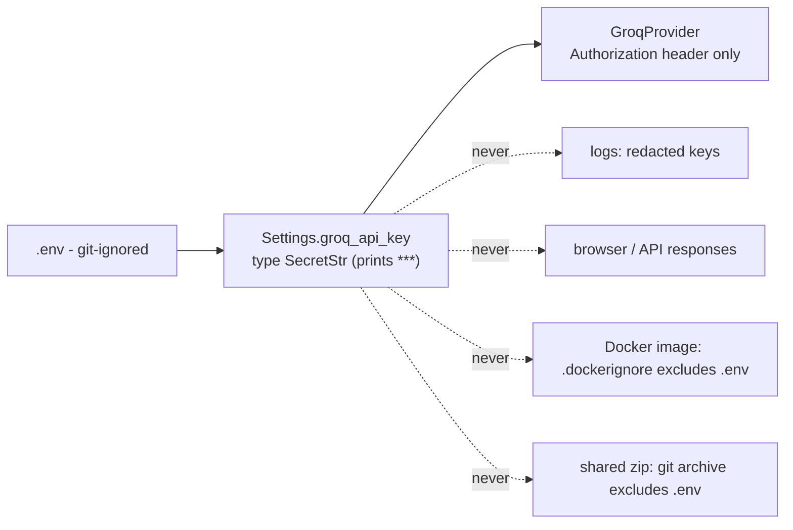

# 08 · Authentication and security

Security isn't a feature added at the end; the roadmap makes it explicit (§41.6). This chapter explains each protection, the attack it prevents, and where it lives.

## The threat model in one picture

## Passwords: hashing, not encryption

We never store passwords, only a **hash**: a one-way fingerprint. On login we hash the attempt and compare.

- **Why argon2id?** Ordinary hashes (SHA-256) are *fast*, so an attacker with a leaked database can try billions of guesses per second. argon2id is deliberately slow and memory-hungry, which makes mass guessing impractical.
- **Salt:** a random value per password, so two users with the same password have different hashes.
- **Rehash on login:** if the recommended argon2 parameters change, the next successful login quietly upgrades the stored hash ([`auth/service.py:44`](../backend/app/auth/service.py#L44)).

Code: [`core/security.py:17` `hash_password`](../backend/app/core/security.py#L17) and [`verify_password`](../backend/app/core/security.py#L21).

### Not revealing which emails exist

If "wrong password" responded differently from "no such user", an attacker could discover registered emails. Both cases return the same message, and to equalise *timing* too, an unknown email is still checked against a dummy hash ([`security.py:14` `_DUMMY_HASH`](../backend/app/core/security.py#L14), used in [`auth/service.py:42`](../backend/app/auth/service.py#L42)). Otherwise "unknown email" would answer measurably faster.

## Sessions: how the server remembers you

HTTP is stateless: each request arrives with no memory of the last one. After login the server gives the browser a **cookie**, and the browser sends it back automatically on every request.

- **Create:** [`auth/service.py:50` `create_session`](../backend/app/auth/service.py#L50)
- **Resolve:** [`resolve_session`](../backend/app/auth/service.py#L59)
- **Dependency used by every protected endpoint:** [`deps.py:60` `current_user`](../backend/app/api/deps.py#L60)

**Design decisions:**

| Decision | Reason |
|---|---|
| **Server-side sessions** (a row in the DB) instead of JWTs | Logout really works: delete the row and the token is dead immediately. A JWT stays valid until it expires. |
| **Store only the hash of the token** | A leaked sessions table can't be replayed as cookies |
| **Sliding expiry** (renewed if used after 1 h, [`auth/service.py:77`](../backend/app/auth/service.py#L77)) | Active users stay signed in; idle sessions die after 14 days. Renewing at most hourly avoids a DB write on every request. |
| **Expired sessions deleted on sight** | Keeps the table clean |

### Cookie flags

Set in [`deps.py:42` `set_session_cookie`](../backend/app/api/deps.py#L42):

| Flag | Protects against |
|---|---|
| `HttpOnly` | JavaScript (including injected malicious scripts) can't read the cookie |
| `SameSite=Lax` | The browser won't attach it to cross-site POSTs (the main CSRF vector) |
| `Secure` | Only sent over HTTPS. On when `ENV=prod`, unless `COOKIE_SECURE=false` is set for plain-HTTP local and LAN use. |
| `Max-Age` | Expiry in the browser, matching the server's |

## CSRF: when another website uses your login

**The attack:** you're signed in to our app, then you visit `evil.example`. Its page contains a form that POSTs to our API. Your browser might helpfully attach your cookie, and the request would run *as you*.

Two independent layers ("defence in depth"):
1. the `SameSite=Lax` cookie
2. the **Origin check** for every non-GET request: [`csrf.py:20` `OriginCheckMiddleware`](../backend/app/core/csrf.py#L20). It compares the `Origin` header with the server's own address ([`csrf.py:33`](../backend/app/core/csrf.py#L33)) and an allowlist.

Requests **without** an Origin header (curl, scripts) are allowed: they can't carry a victim's browser cookies.

### Why same-origin matters

In development the Vite proxy, and in production nginx, put the UI and the API on **one origin**. So:
- no CORS configuration is needed
- cookies just work
- the Origin check has a simple rule

nginx forwards the browser's `Host` header ([`nginx.conf:24`](../frontend/nginx.conf#L24)), so the backend's "own origin" matches what the browser sees.

## Authorization: "is this yours?"

Authentication answers *who are you*. **Authorization** answers *may you do this*. The rules:

1. **The user id comes only from the session**, never from a request body or URL.
2. **Every query on a conversation filters by `user_id`** ([chapter 07](07-database.md#a-query-pattern-youll-see-everywhere)).
3. **Someone else's resource returns 404, not 403.** A 403 would confirm "this exists, but it's not yours", which itself leaks information.

Tested exhaustively for every endpoint: [`test_other_users_conversations_are_invisible`](../backend/tests/integration/test_conversations.py).

## Rate limiting: the token bucket

Limits stop brute-force logins and quota-burning spam:

| Limiter | Key | Default |
|---|---|---|
| Login | IP + email | 5 per minute |
| Register | IP | 5 per minute |
| Chat | user id | 20 per minute |

**The token bucket algorithm** ([`core/ratelimit.py:19`](../backend/app/core/ratelimit.py#L19)):

Picture a bucket holding 5 tokens that refills continuously at 5 per minute:
- Short bursts are allowed.
- The sustained rate is capped.
- The `Retry-After` header tells the client exactly how long to wait.

**Limitation (documented):** buckets live in the process's memory. With several server processes each would have its own bucket; that's when you'd move them into a shared store such as Redis (V6).

## Secrets

Several layers check this:
- `.gitignore`
- log redaction ([`logging.py:16`](../backend/app/core/logging.py#L16))
- the doctor printing only the key's *length*
- `.dockerignore` files
- before every commit, the staged diff was scanned for key patterns

## Input limits

| Limit | Where | Why |
|---|---|---|
| Message ≤ 8000 characters | [`chat/service.py`](../backend/app/chat/service.py#L114) (`prepare_new_turn`) | Cost and the context budget |
| Hard transport cap of 100k characters | [`schemas/chat.py:9`](../backend/app/schemas/chat.py#L9) | Never even parse huge bodies |
| nginx body limit of 1 MB | [`nginx.conf`](../frontend/nginx.conf) | Same, at the edge |
| System prompt ≤ 4000 characters | [`schemas/conversations.py:8`](../backend/app/schemas/conversations.py#L8) | Budget |
| Request ID format validated | [`middleware.py:16`](../backend/app/core/middleware.py#L16) | Stops header injection into logs |

## What is *not* protected yet (honest list)

- No password reset or email verification, and **open registration**.
- Plain HTTP in the Docker stack (fine on localhost; use HTTPS beyond that).
- In-memory rate limits.
- **Prompt injection:** users can try to talk the model out of its system prompt. That's harmless in V1 because the model has no tools or private data. It becomes critical in V2/V4, when documents and tools arrive.

These are listed in [`docs/v1-acceptance.md`](../docs/v1-acceptance.md).

**Next:** [09 · The chat pipeline →](09-chat-pipeline.md)
