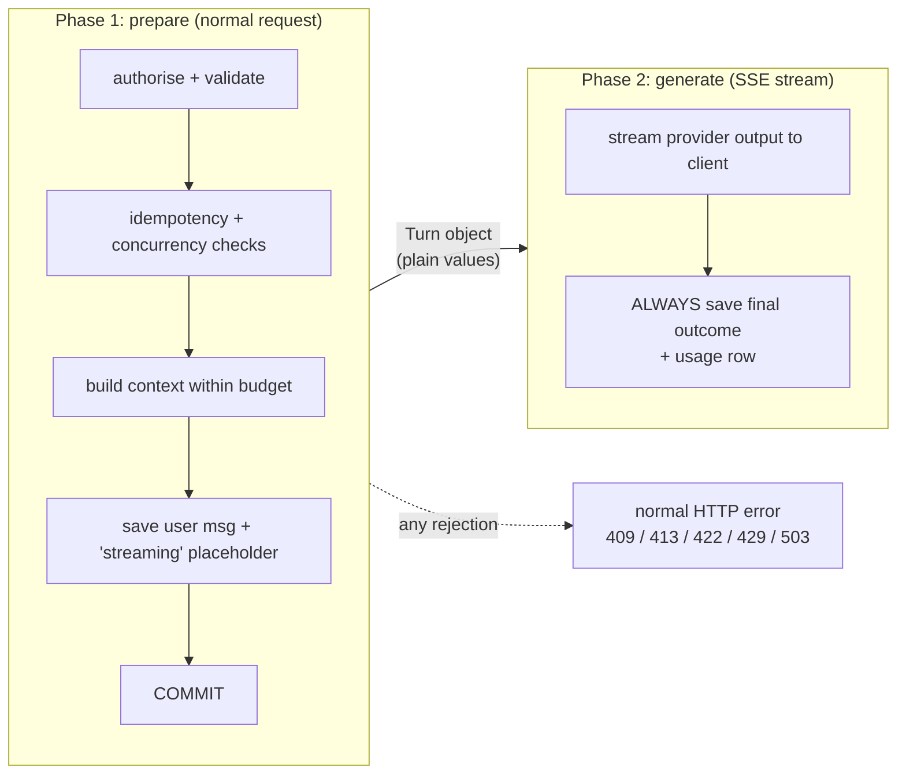
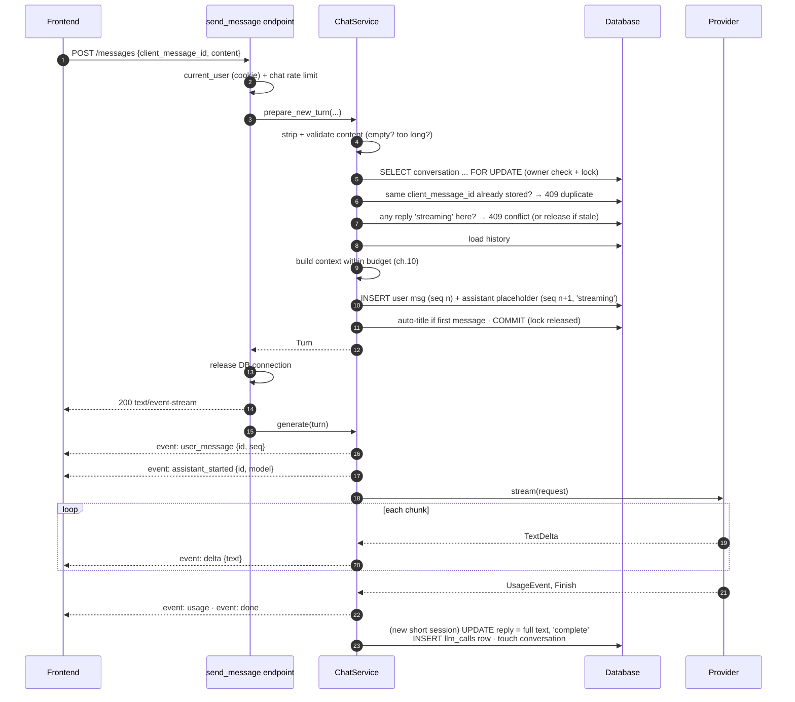
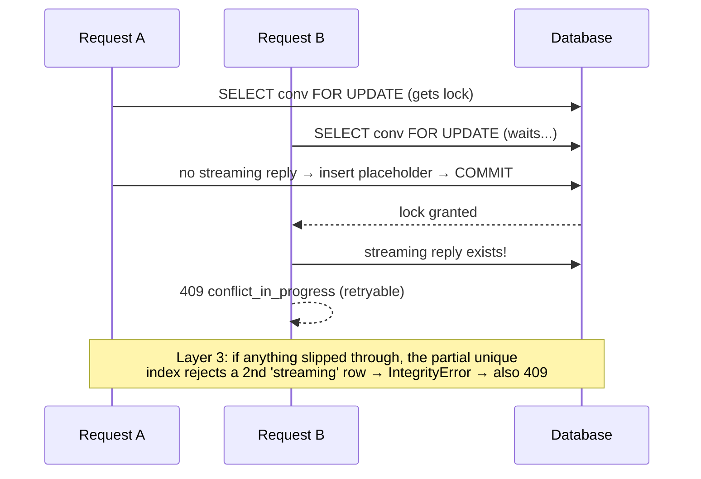
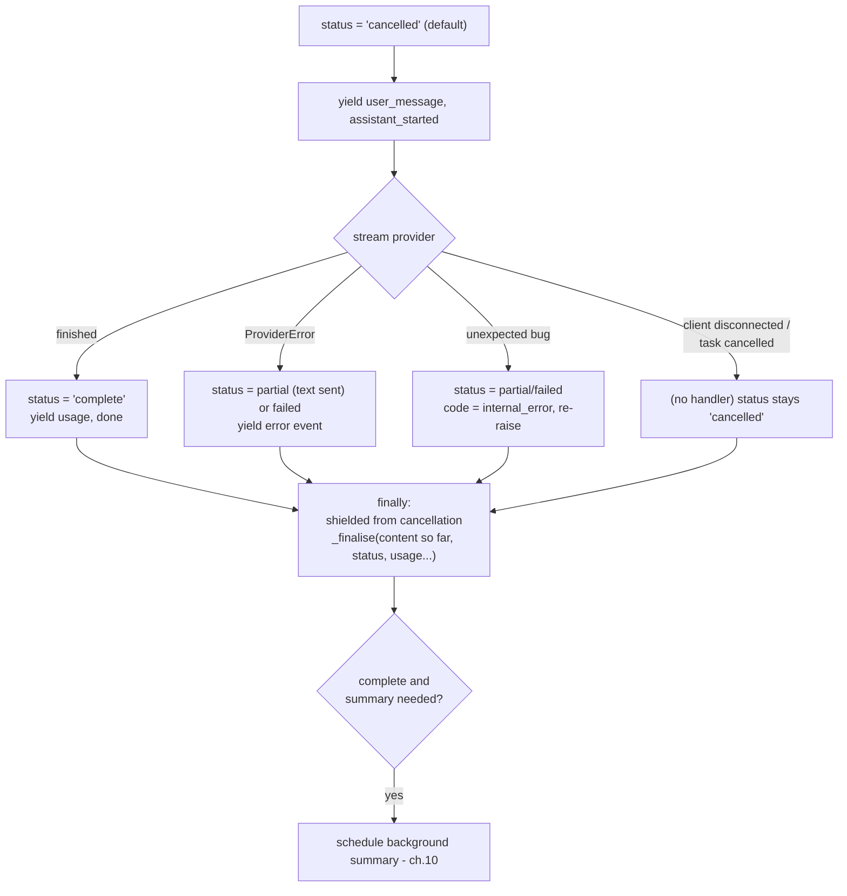
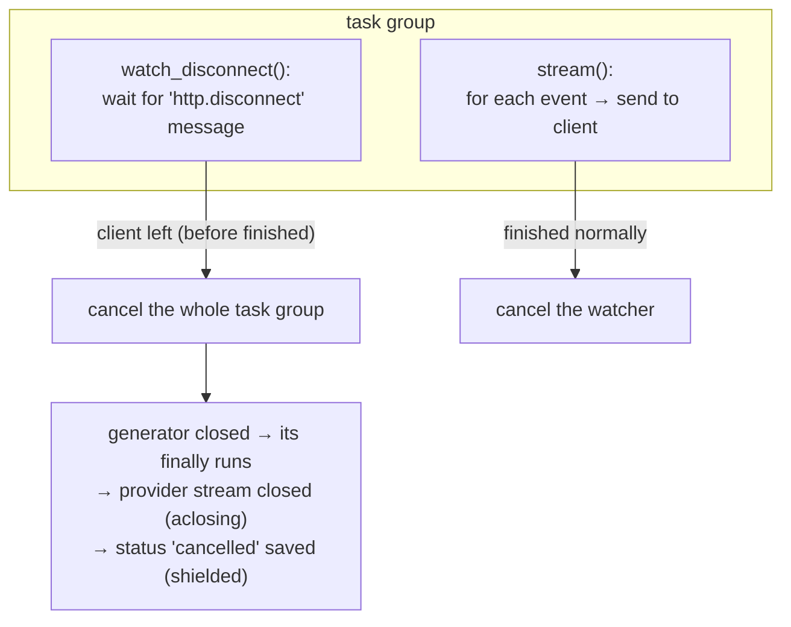
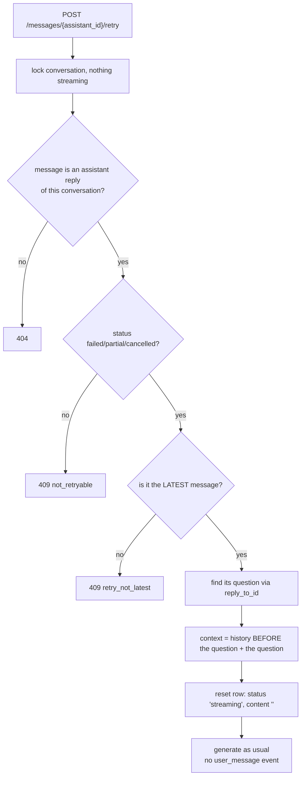

# 09 · The chat pipeline: the heart of the app

Everything in chapters 03–08 comes together here. Sending a chat message *looks* simple, but a robust implementation has to answer hard questions:
- What if the user double-clicks Send?
- What if two tabs send at once?
- What if the AI fails halfway through a reply?
- What if the user presses Stop, or the server crashes mid-reply?

**Main file:** [`backend/app/chat/service.py`](../backend/app/chat/service.py). **Endpoints:** [`backend/app/api/chat.py`](../backend/app/api/chat.py).

## Two phases

The core design idea: split each turn into a **prepare** phase and a **generate** phase.

**Why split?** Once streaming starts, the HTTP status is already 200 and can't change ([chapter 04](04-streaming-and-sse.md#two-kinds-of-errors)). So everything that *can* be rejected cleanly is checked **before** the stream starts. Phase 1 ends by committing, so the user's message is safely stored before the AI is even contacted.

The hand-off object is [`Turn`](../backend/app/chat/service.py#L80). It holds plain values (ids, the prepared request), not live database objects, because phase 2 uses different database sessions.

## The complete sequence (happy path)

Code map:

| Step | Where |
|---|---|
| Endpoint | [`api/chat.py:46` `send_message`](../backend/app/api/chat.py#L46) |
| Prepare | [`service.py:114` `prepare_new_turn`](../backend/app/chat/service.py#L114): lock at line 132, checks at 133–134, inserts at ~140–157, commit at 163 |
| Generate | [`service.py:228` `generate`](../backend/app/chat/service.py#L228) |
| Finalise | [`service.py:534` `_finalise`](../backend/app/chat/service.py#L534) |

## Concurrency and duplicates

Two different problems that are easily confused:

| Problem | Example | Defence |
|---|---|---|
| **Duplicate** | The same message submitted twice: double-click, or a network retry | `client_message_id` (an **idempotency key**) |
| **Concurrent** | Two *different* messages sent to the same conversation at the same moment | Row lock, plus the "one streaming reply" rule |

### Idempotency keys

The frontend generates a random UUID **per message** and sends it along. If the same id arrives again, the server doesn't create a second message. It answers 409 `duplicate` and points to the existing message and reply ([`_reject_duplicate`](../backend/app/chat/service.py#L477)). The database's unique constraint backs this up ([chapter 07](07-database.md#rules-the-database-enforces)).

> Generic definition: an operation is **idempotent** if doing it twice has the same effect as doing it once. Payment APIs rely heavily on idempotency keys, for the same reason.

### Three layers against concurrent sends

1. **Row lock:** concurrent prepares for one conversation run one at a time.
2. **Application check:** [`_reject_in_progress`](../backend/app/chat/service.py#L499).
3. **Database index**, with the resulting `IntegrityError` turned into 409 by [`_commit_guarded`](../backend/app/chat/service.py#L521).

Integration test [`test_concurrent_sends_produce_exactly_one_generation`](../backend/tests/integration/test_chat.py) fires 4 sends at once and checks that the sequence has no gaps or duplicates.

### Stale "streaming" rows

If the server crashed mid-reply, a row could stay `streaming` forever and block the conversation for good. Two safety valves:
- **At startup**, every `streaming` row becomes `failed / server_restarted` ([`release_abandoned_streams`](../backend/app/chat/service.py#L606), called from [`main.py:37`](../backend/app/main.py#L37)). This is safe because there's a single server process.
- **On use**, a `streaming` row older than 5 minutes is considered abandoned and released ([`service.py:505`](../backend/app/chat/service.py#L505)).

## The generate phase: every exit is handled

`generate` is an **async generator**: it `yield`s events as they happen. Its structure is what guarantees an outcome is always recorded:

Key techniques (see [`service.py:228-318`](../backend/app/chat/service.py#L228)):
- **The default is `cancelled`.** If execution leaves the generator any way other than the handled paths (the client vanished), the stored status is correct without needing a special handler.
- **`aclosing(...)`** ([line 255](../backend/app/chat/service.py#L255)) guarantees the provider's stream is closed, and with it the HTTP connection to Groq, even when we exit early. That stops quota being consumed.
- **`finally` plus `CancelScope(shield=True)`** ([line 302-305](../backend/app/chat/service.py#L302)). When a task is cancelled, any further `await` is normally cancelled too, so saving to the database would fail. The shield says "let this cleanup finish". Without it, cancelled replies would stay `streaming` forever.
- **Finalisation uses a new, short database session** ([`_finalise`](../backend/app/chat/service.py#L534)). The request's own session was closed before streaming ([`api/chat.py`](../backend/app/api/chat.py#L46), `await db.close()`), so a 30-second reply doesn't hold a pooled connection.
- **User-facing error text** is chosen from a fixed table ([`_PUBLIC_ERRORS`](../backend/app/chat/service.py#L57)), so provider internals never reach the user.

### Outcomes table

| What happened | Message status | `error_code` | `llm_calls.status` |
|---|---|---|---|
| Normal | `complete` | — (or `length_limit` if cut by max_tokens) | `complete` |
| Provider failed before text | `failed` | e.g. `provider_rate_limited` | `failed` |
| Provider failed after text | `partial` | e.g. `provider_stream_interrupted` | `partial` |
| User pressed Stop / closed the tab | `cancelled` | `client_disconnected` | `cancelled` |
| Bug in our code | `failed`/`partial` | `internal_error` | same |
| Server restarted mid-reply | `failed` | `server_restarted` | (none) |

## Cancellation: the tricky part

When the user presses **Stop**, the browser closes the connection. The backend must notice **immediately** and stop the Groq request.

**The problem discovered:** Starlette's standard `StreamingResponse` (under modern servers) only notices a disconnect when its *next write* fails. While we're waiting for Groq's next chunk nothing is being written, so the server kept generating, and spending quota, for a user who had already left.

**The solution:** a custom response class that runs two tasks side by side ([`api/sse.py:35` `SSEResponse`](../backend/app/api/sse.py#L35)):

This was **verified against real Groq**: curl was killed 1.2 s into a long answer, and the 1282 characters received so far were saved as `cancelled / client_disconnected` ([`docs/decisions.md`](../docs/decisions.md) #16).

## Retry

A failed, partial or cancelled reply can be **regenerated in place**. The same row is reused and nothing is added:

Code: [`prepare_retry`](../backend/app/chat/service.py#L181).

**Why only the latest reply?** Regenerating a reply in the middle would leave later messages answering a question whose context had changed. Supporting that properly needs "branches", which V1 doesn't have ([`docs/decisions.md`](../docs/decisions.md) #17).

## Small but thoughtful details

- **Auto-title:** the first message, whitespace-collapsed and cut to 60 characters with "…", becomes the title. No extra AI call is needed ([`_title_from`](../backend/app/chat/service.py#L649)).
- **Free-tier guard:** if the estimated request plus `max_tokens` exceeds the model's tokens-per-minute limit, it's rejected *before* calling Groq, because it can never succeed ([`service.py:453`](../backend/app/chat/service.py#L453)).
- **Length-limit note:** `finish_reason == "length"` is stored as `error_code = length_limit` on a *complete* message, and the UI explains it. This came from a real test where answers were silently cut mid-word ([`_outcome_code`](../backend/app/chat/service.py#L634)).
- **Rate-limit headers** from Groq (tokens remaining) are logged on every call, as a basis for future quota tracking ([`_log_rate_limit`](../backend/app/chat/service.py#L660)).

## Exercise
Trace this with the fake provider:
1. Start the backend with `PROVIDER=fake`.
2. Send `hello one two three four five [fake:cut]`.
3. Predict the SSE events and the final database row, then check them with curl (README) and `psql`.
4. Retry it, and predict what changes.

**Next:** [10 · Context and memory →](10-context-and-memory.md)
