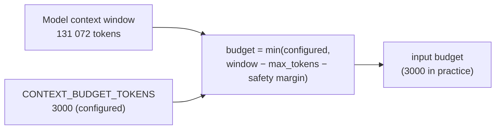
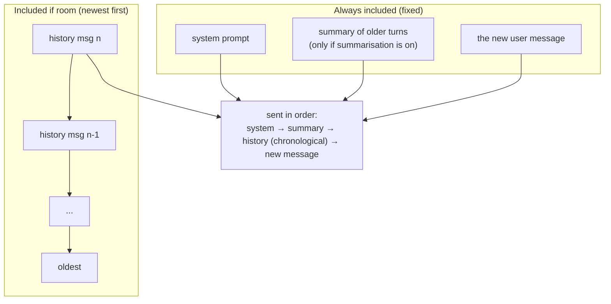
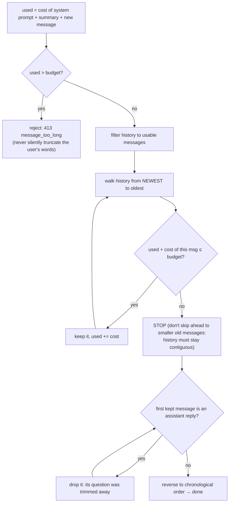
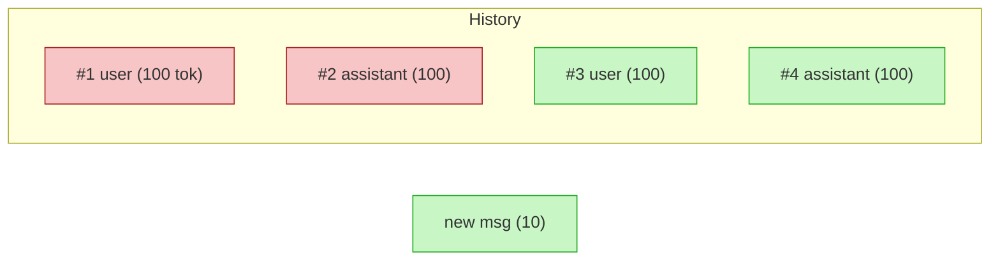
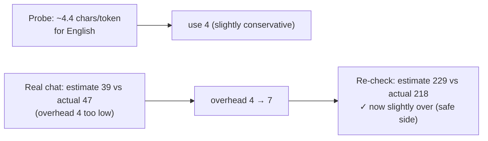
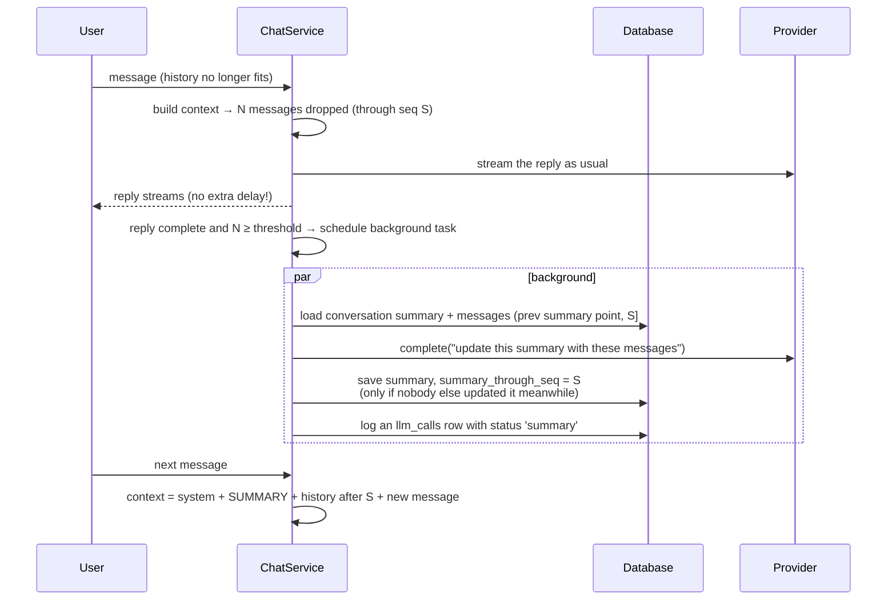

# 10 · Context and memory

Since the model remembers nothing ([chapter 03](03-how-llm-apis-work.md#a-language-model-has-no-memory)), we have to decide **what to send it** on every turn. Send too little and it forgets; send too much and requests become slow and expensive, or fail outright.

Files:
- [`conversations/context.py`](../backend/app/conversations/context.py)
- [`conversations/tokens.py`](../backend/app/conversations/tokens.py)
- the summary code in [`chat/service.py`](../backend/app/chat/service.py#L321)

## The budget



[`compute_budget`](../backend/app/conversations/context.py#L43) takes the *smaller* of what we choose and what the model allows. The 3000 default comes from the **measured** 8000 tokens-per-minute free-tier limit ([chapter 03](03-how-llm-apis-work.md#rate-limits-the-real-constraint)): 3000 in plus 800 out leaves room for about two messages a minute.

## What goes in, and in what order



## The trimming algorithm

[`build_context`](../backend/app/conversations/context.py#L64), step by step:



Four details worth understanding:

1. **Reject rather than truncate** ([line 80](../backend/app/conversations/context.py#L80)). Cutting off the end of a user's message would silently change its meaning.
2. **Stop at the first message that doesn't fit** ([line 92](../backend/app/conversations/context.py#L92)). Skipping over a large message to fit older small ones would create gaps that confuse the model.
3. **No orphaned answers** ([line 98](../backend/app/conversations/context.py#L98)). An assistant reply whose question was dropped makes no sense on its own.
4. **What counts as usable history** ([`_usable`](../backend/app/conversations/context.py#L50)):
   - complete messages
   - partial and cancelled replies, with a note telling the model "this was interrupted"
   - *Not* failed empty replies, and not the in-flight placeholder.

An example with a small budget:



With a budget of about 320: the new message (10), then #4 (110) and #3 (110) fit, but #2 doesn't, so we stop. #1 and #2 are dropped and #3, #4 and the new message are sent. This exact scenario is unit-tested in [`test_context.py`](../backend/tests/unit/test_context.py).

## Estimating tokens without a tokenizer

Exact counting needs the model's own tokenizer, a large dependency that differs per model. Instead we **estimate**:

```
tokens(message) ≈ ceil(characters / 4) + 7
```

Code: [`tokens.py`](../backend/app/conversations/tokens.py). The `+7` covers per-message formatting overhead (role markers and so on).

**How these numbers were chosen, by calibration rather than guesswork:**



Every `llm_calls` row stores **both** `estimated_input_tokens` and the real `input_tokens`, so the estimator can be re-checked against real data at any time (V3 makes this systematic).

> **Over-estimating is safe:** we send slightly less history than we could. **Under-estimating is dangerous:** a request could exceed the limit and fail. So the rounding is deliberately cautious.

## Summaries: long-term memory within a conversation (optional)

Trimming forgets old messages. If the customer gave their order number 20 messages ago, it's gone. **Summarisation** compresses dropped history into a short note:



Design decisions ([`docs/decisions.md`](../docs/decisions.md) #27):

| Decision | Why |
|---|---|
| **Off by default** (`CONTEXT_SUMMARIZATION=false`) | It costs an extra AI call. A real tight-budget test used about 0.8× the chat tokens. |
| **Runs in the background *after* the reply** | The user never waits for it |
| **Only after ≥ N newly dropped messages** (`SUMMARY_MIN_NEW_MESSAGES`) | Not on every turn, which keeps cost down |
| **Incremental:** old summary + new messages → new summary | Never re-reads the whole conversation |
| **Optimistic concurrency** (update only if `summary_through_seq` is unchanged) | Two overlapping background runs can't overwrite a newer summary with an older one ([`service.py:396`](../backend/app/chat/service.py#L396)) |
| **Capped at a third of the budget** | A long summary can never crowd out the user's message. A test caught exactly this failure. ([`service.py:442`](../backend/app/chat/service.py#L442)) |
| **Prompt forbids invention** | The summary must keep facts (names, order numbers) and must not hallucinate ([`SUMMARY_INSTRUCTIONS`](../backend/app/chat/service.py#L620)) |
| **Recorded in `llm_calls`** | The cost is visible |

Code:
- [`_summary_target`](../backend/app/chat/service.py#L321), [`_schedule_summary`](../backend/app/chat/service.py#L328), [`_summarize`](../backend/app/chat/service.py#L335)
- background task tracking: [`BACKGROUND_TASKS`](../backend/app/chat/service.py#L618)

`BACKGROUND_TASKS` keeps a reference to each running task, so Python's garbage collector can't destroy it mid-flight. At shutdown the app waits up to 10 s for these tasks ([`drain_background_tasks`](../backend/app/chat/service.py#L628)).

**Verified with the real model:** a customer gave their name and order number in turn 1. By turn 6 those messages had been trimmed, yet the answer was still *"Priya Shah, order 88417, cracked lid"*, recalled from the summary.

## Conversation memory vs long-term memory

| | This chapter (V1) | V5 (future) |
|---|---|---|
| Scope | One conversation | Across all of a user's conversations |
| Content | Recent messages, plus an optional rolling summary | Selected facts and preferences |
| Control | Automatic | The user can inspect, correct and delete |

The roadmap keeps these separate on purpose (§6.3, §31).

## Exercise
Set `CONTEXT_BUDGET_TOKENS=450`, `CONTEXT_SUMMARIZATION=true` and `SUMMARY_MIN_NEW_MESSAGES=2`. Chat for six turns with facts in the first message, then ask about them.

Inspect with:
```sql
SELECT summary, summary_through_seq FROM conversations;
SELECT status, total_tokens FROM llm_calls;
```

**Next:** [11 · The frontend →](11-frontend.md)
