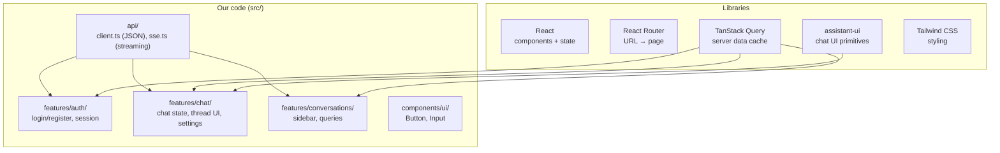
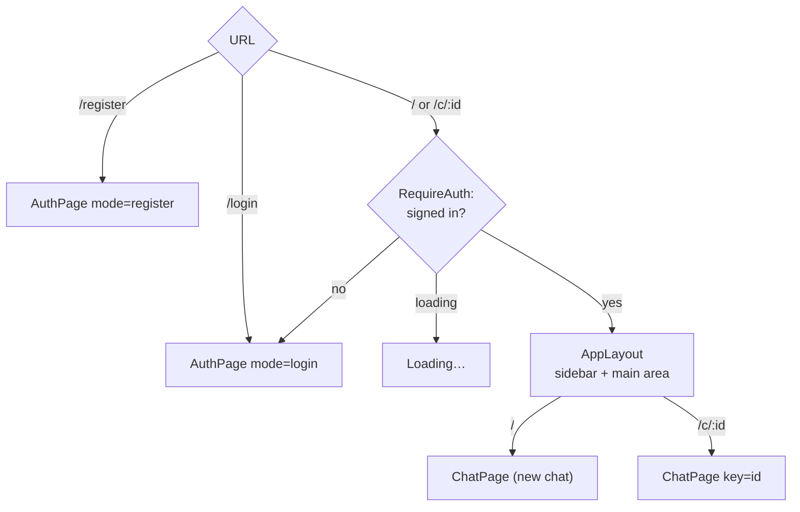
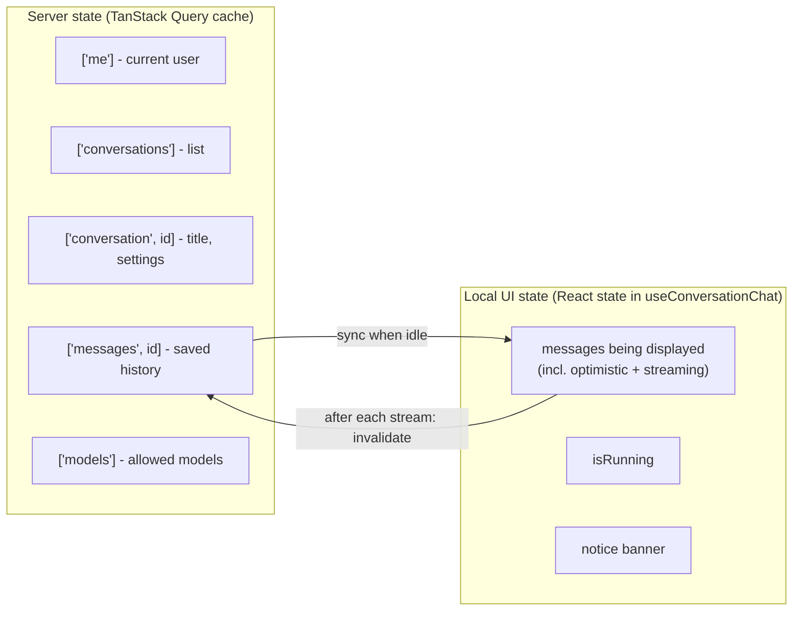
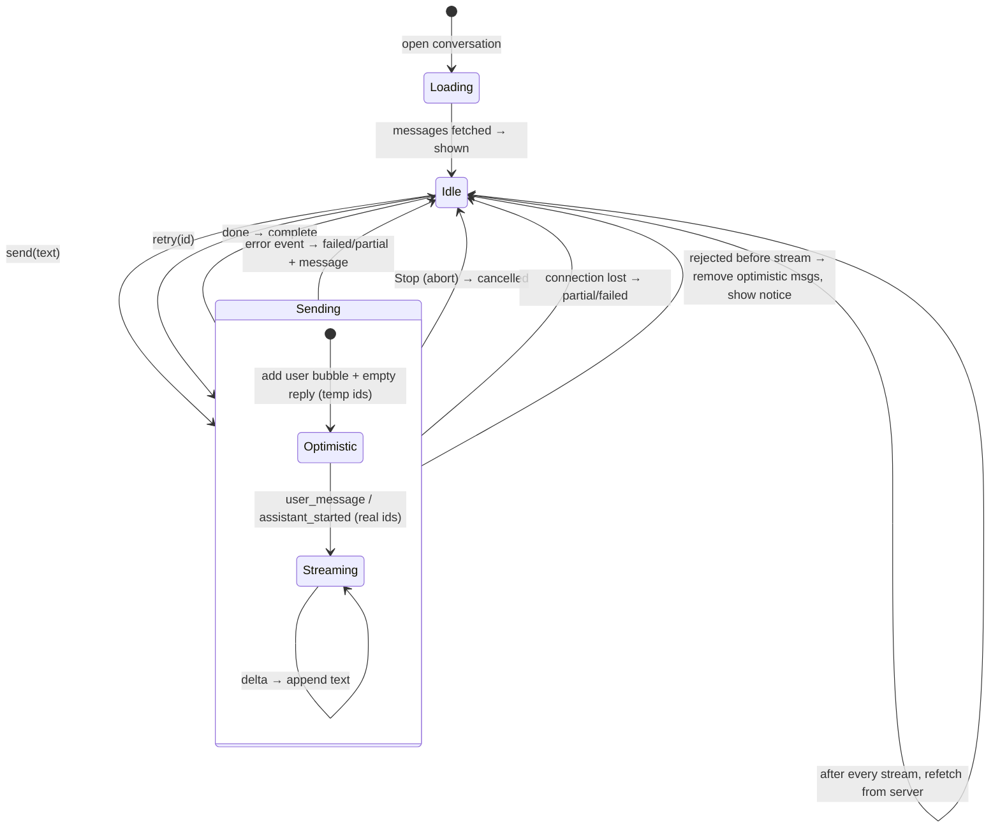
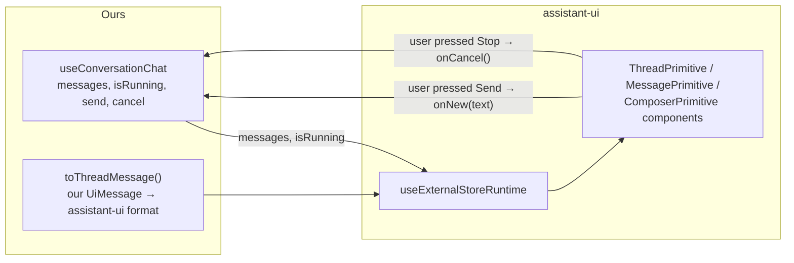
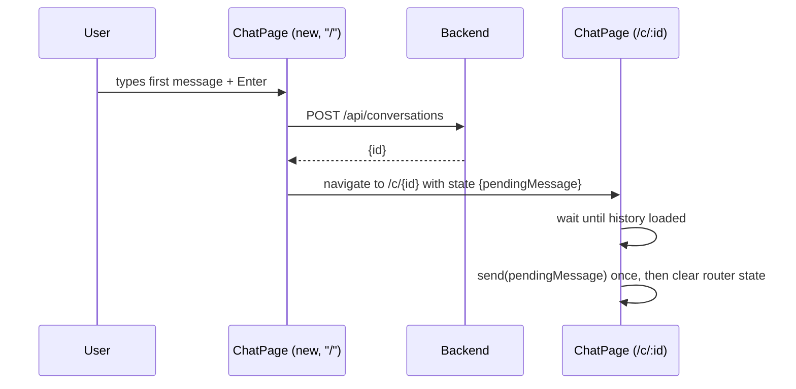
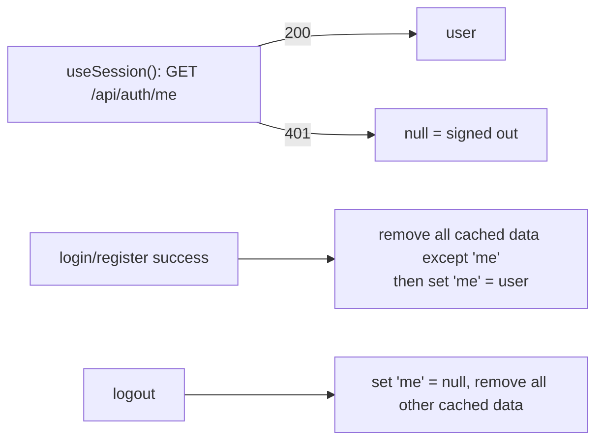

# 11 · The frontend

The frontend is a **single-page application** (SPA): the browser loads one HTML page and one JavaScript bundle, and from then on React redraws parts of the page as data changes. There are no full page reloads.

All code is in [`frontend/src/`](../frontend/src/).

## The building blocks

## React in 60 seconds

- A **component** is a function that returns what to display, e.g. `<Sidebar/>` or `<ChatPage/>`.
- **State** (`useState`) is data that, when changed, makes React re-run the component and update the screen.
- **Effects** (`useEffect`) run side work *after* rendering: fetching, timers, syncing.
- **Refs** (`useRef`) hold values that survive re-renders *without* causing them (for example the current `AbortController`).
- **Hooks** are functions starting with `use…` that bundle state and logic for reuse. Our main one is `useConversationChat`.

## Pages and routing

Defined in [`App.tsx:87-95`](../frontend/src/App.tsx#L87). Notes:
- **`RequireAuth`** ([`App.tsx:22`](../frontend/src/App.tsx#L22)) protects every chat route in one place.
- **`key={conversationId}`** ([`App.tsx:75`](../frontend/src/App.tsx#L75)) makes React create a *fresh* `ChatPage` when you switch conversations, so messages from one chat can never leak into another's state.
- **Mobile:** the sidebar becomes a slide-out drawer ([`AppLayout`](../frontend/src/App.tsx#L30)).

## Two kinds of state

The most important frontend concept in this project:

- **Server state** lives on the backend; the frontend holds a *cache* of it. TanStack Query fetches it, caches it under a **query key**, and refetches when told the data is stale ("invalidated"). The queries are in [`conversations/queries.ts`](../frontend/src/features/conversations/queries.ts) and [`auth/useSession.ts`](../frontend/src/features/auth/useSession.ts).
- **Local state** is what's on screen *right now*, including text that hasn't been saved yet (a reply mid-stream).

**The golden rule here: the server is the source of truth.** After every stream, the frontend re-fetches the conversation from the server and replaces its local copy ([`useConversationChat.ts:179-181`](../frontend/src/features/chat/useConversationChat.ts#L179)). Any drift between screen and database lasts at most one round-trip.

## The chat hook: a state machine

[`features/chat/useConversationChat.ts`](../frontend/src/features/chat/useConversationChat.ts) is the frontend's counterpart to `ChatService`. Its lifecycle:

Map of the code:

| Piece | Where |
|---|---|
| Optimistic messages with temporary ids `local-user-…` | [`send`, line 188](../frontend/src/features/chat/useConversationChat.ts#L188) |
| Event handling (`case "delta"`…) | [`stream`, line 105](../frontend/src/features/chat/useConversationChat.ts#L105) |
| The four failure branches (aborted / interrupted / rejected) | [lines 155-173](../frontend/src/features/chat/useConversationChat.ts#L155) |
| Retry | [line 209](../frontend/src/features/chat/useConversationChat.ts#L209) |
| Stop | [line 218](../frontend/src/features/chat/useConversationChat.ts#L218) (aborts the fetch, the server sees the disconnect, [chapter 09](09-chat-pipeline.md#cancellation-the-tricky-part)) |
| Turning stored error codes into human text, identical to the server's wording | [`STORED_ERROR_TEXT`](../frontend/src/features/chat/useConversationChat.ts#L26) |

**Optimistic UI:** your message appears *instantly*, before the server confirms it. If the server rejects it (too long, rate limited), the optimistic bubbles are removed and a notice explains why.

**Navigating away does not cancel.** If you switch conversations mid-reply, the request keeps running and the server finishes and saves the reply. When you come back, the hook sees a `streaming` message from the server, polls every second until it settles ([`refetchInterval`, line 80](../frontend/src/features/chat/useConversationChat.ts#L80)), and disables sending meanwhile (`serverBusy`, [line 99](../frontend/src/features/chat/useConversationChat.ts#L99)). Why this design rather than aborting on unmount is a story in [chapter 15](15-lessons-learned.md).

## assistant-ui: renting a chat UI, keeping control of the data

Building a polished chat UI yourself (auto-scroll, a composer that grows, Enter to send, Stop button states, markdown) takes a lot of work. **assistant-ui** provides these as unstyled **primitives**. We chose its **ExternalStoreRuntime**, meaning *"you own the messages; we just display them and report user actions."*

| Part | Where |
|---|---|
| The adapter wiring | [`ChatPage.tsx:77` `useExternalStoreRuntime`](../frontend/src/features/chat/ChatPage.tsx#L77) |
| Status conversion (`streaming` → "running", `failed` → "incomplete/error"…) | [`toThreadMessage`, line 16](../frontend/src/features/chat/ChatPage.tsx#L16) |
| The visual thread built from primitives | [`Thread.tsx`](../frontend/src/features/chat/Thread.tsx) |

In `Thread.tsx`, look at:
- `ThreadPrimitive.Viewport` (auto-scrolling area)
- `Empty` (welcome screen)
- `Messages` (which renders `UserMessage` / `AssistantMessage`)
- `ComposerPrimitive` (input, Send, and Cancel shown as "Stop")

**Retry** isn't part of assistant-ui's model, so it is passed through a small React **context** ([`chatActions.ts`](../frontend/src/features/chat/chatActions.ts)) and shown only on the *last* message when its error is retryable ([`Thread.tsx` `AssistantMessage`](../frontend/src/features/chat/Thread.tsx#L89)).

**Markdown:** Groq answers with lists and bold text. `MarkdownTextPrimitive` plus `remark-gfm` render them ([`Thread.tsx:86`](../frontend/src/features/chat/Thread.tsx#L86)), styled by the `.prose-chat` rules in [`index.css`](../frontend/src/index.css). It also animates text smoothly. That's why a script reading the page mid-animation once saw a "truncated" reply that was actually complete in the database.

> Why assistant-ui and not Meta's Astryx? Astryx was in beta. A mature AI-chat library with an "external store" mode let our backend stay in charge ([`docs/decisions.md`](../docs/decisions.md) #5, #19).

## Creating a conversation on the first message

The "New chat" screen has no conversation yet. Creating an empty one on every click would litter the sidebar, so creation is deferred:

[`ChatPage.tsx:52-70`](../frontend/src/features/chat/ChatPage.tsx#L52). A ref (`sentPending`) makes sure it's sent exactly once, even under React StrictMode's double-run of effects in development.

## The API layer

| File | Purpose |
|---|---|
| [`api/types.ts`](../frontend/src/api/types.ts) | TypeScript mirror of the backend schemas and SSE event types |
| [`api/client.ts`](../frontend/src/api/client.ts) | `api.*` functions for JSON endpoints. Every failure becomes an `ApiError` carrying the backend's `code`, `retryable`, `retryAfter` and `requestId` ([line 4](../frontend/src/api/client.ts#L4)). Network failures become `network_error`. |
| [`api/sse.ts`](../frontend/src/api/sse.ts) | Streaming POST reader ([chapter 04](04-streaming-and-sse.md#reading-the-stream-in-the-browser)) |

All requests use `credentials: "same-origin"`, so the session cookie is sent automatically and JavaScript never touches it.

## Auth on the frontend

[`useSession.ts`](../frontend/src/features/auth/useSession.ts). Clearing the cache on login and logout guarantees **no previous user's data is ever shown**. Why it uses `removeQueries` instead of the more obvious `clear()` is a lesson in [chapter 15](15-lessons-learned.md).

## Styling

- **Tailwind CSS:** utility classes in the markup (`flex`, `rounded-2xl`, `px-4`), with no separate CSS files per component.
- **Design tokens** in [`index.css`](../frontend/src/index.css): colours defined once as CSS variables (`--primary`, `--muted`…), redefined for dark mode (`prefers-color-scheme`), and exposed to Tailwind via `@theme`. Change a token and the whole UI follows.
- **shadcn-style components** ([`components/ui/`](../frontend/src/components/ui/)): `Button` with variants, built with `class-variance-authority`, which maps variant names to class lists.

## Exercise
Open the browser DevTools Network tab, send a message, and click the `/messages` request. In **EventStream** (Chrome) or **Response** you'll see the SSE events arrive one by one. Then press Stop mid-reply and watch the request get cancelled.

**Next:** [12 · Testing →](12-testing.md)
