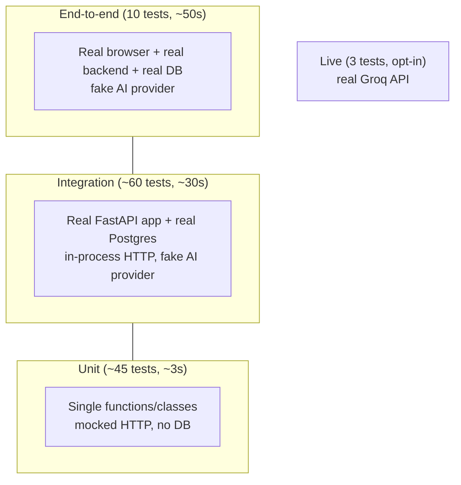
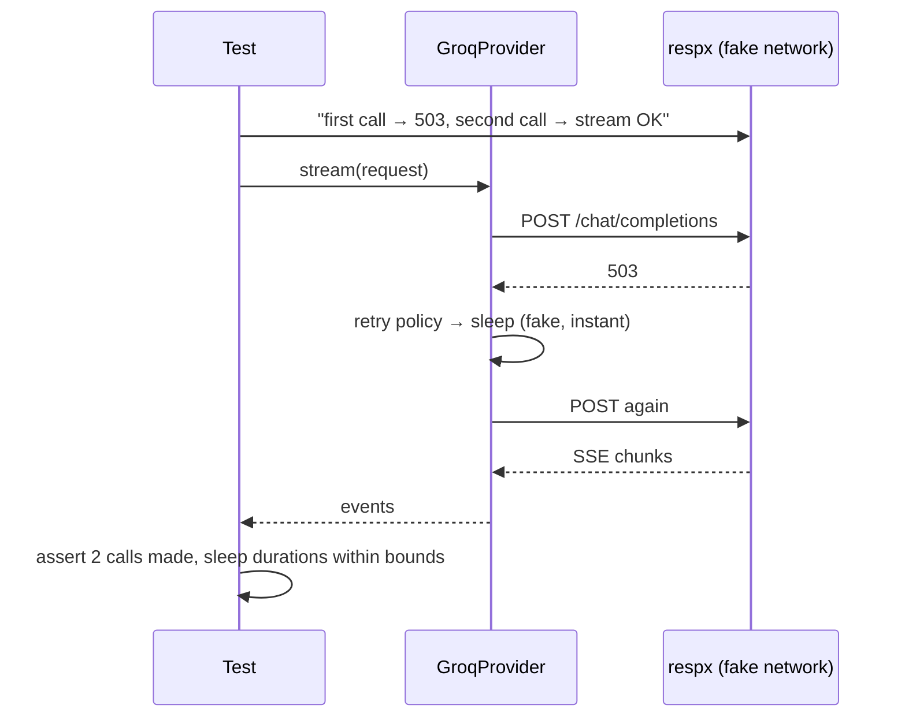
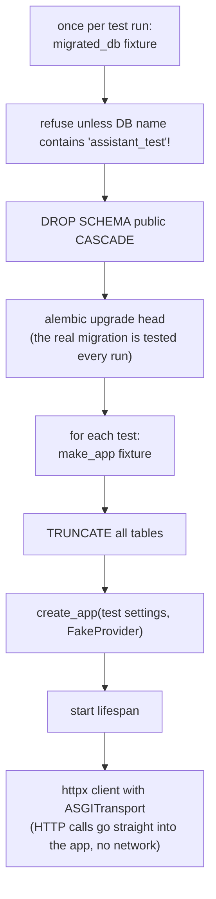
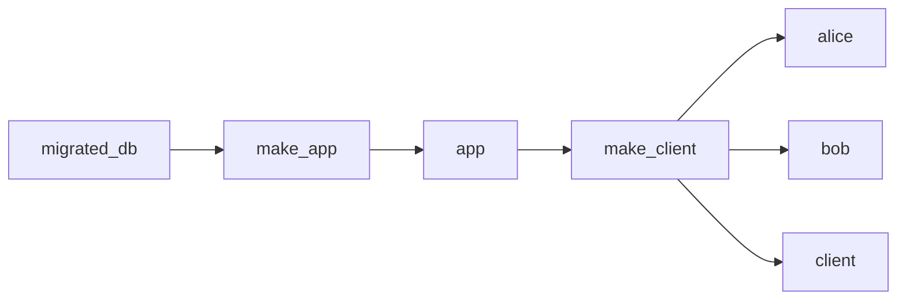
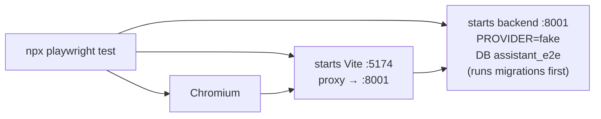

# 12 · Testing

Tests are how this project could honestly claim "it works". They also caught several real bugs that a manual click-through would have missed (listed at the end).

## Three layers of tests



| Layer | Proves | Speed | Example |
|---|---|---|---|
| **Unit** | A piece of logic is correct in isolation | Milliseconds | The retry policy never waits past the deadline |
| **Integration** | The pieces work together with a real database | Seconds | User B gets 404 on user A's conversation |
| **E2E** | A real person's journey works in a real browser | Tens of seconds | Press Stop, reload, see "stopped" plus Retry |
| **Live** | Our assumptions about Groq still hold | Seconds, uses quota | A real stream returns usage |

**The pyramid principle:** many fast tests at the bottom, fewer slow ones at the top. Each layer catches different bugs.

Map of which test covers which roadmap scenario: [`docs/test-matrix.md`](../docs/test-matrix.md).

## Backend tests (pytest)

Location: [`backend/tests/`](../backend/tests/). Configuration lives in the `[tool.pytest.ini_options]` section of [`pyproject.toml`](../backend/pyproject.toml):
- `asyncio_mode = "auto"` lets async test functions just work.
- `-m 'not live'` means live tests only run when you ask for them.

### Unit tests: mocking HTTP with respx

To test the Groq adapter without calling Groq, **respx** intercepts HTTPX requests and returns scripted responses:



Read: [`tests/unit/test_groq_provider.py`](../backend/tests/unit/test_groq_provider.py).

Techniques worth copying:
- **Injected clock and sleep:** the adapter accepts `sleep=` and `clock=` parameters, so tests control time. There's no `time.sleep` and no flakiness.
- **Simulating a dropped connection:** a custom byte stream that yields some data and then raises a network error (the `_CutStream` class).
- **Test names as specifications:** `test_413_request_too_large_is_not_retried_despite_retry_after` *is* the rule.

Other unit files:
- [`test_retry_sse_registry_fake.py`](../backend/tests/unit/test_retry_sse_registry_fake.py) for retry maths, the SSE parser, the registry and the fake provider
- [`test_context.py`](../backend/tests/unit/test_context.py) for the trimming algorithm
- [`test_app.py`](../backend/tests/unit/test_app.py) for the error envelope, request IDs and log redaction

### Integration tests: a real database, wiped for every test



Read [`tests/integration/conftest.py`](../backend/tests/integration/conftest.py):
- **`migrated_db`** ([line 43](../backend/tests/integration/conftest.py#L43)) has a **safety check**: it refuses to wipe any database whose name isn't the test database.
- **`make_app`** ([line 75](../backend/tests/integration/conftest.py#L75)) is a *factory* fixture, so a test can build an app with special settings ("rate limit 2", "database down", "provider not configured").
- **`alice` and `bob`** ([line 130](../backend/tests/integration/conftest.py#L130)) are two already-registered users with **separate cookie jars**, like two browsers. Isolation tests are one-liners because of them.

**Pytest fixtures** are reusable setup functions that tests request by naming them as parameters. Pytest resolves the dependency graph automatically:



Integration test files:
- [`test_auth.py`](../backend/tests/integration/test_auth.py)
- [`test_conversations.py`](../backend/tests/integration/test_conversations.py)
- [`test_chat.py`](../backend/tests/integration/test_chat.py)
- [`test_health_db.py`](../backend/tests/integration/test_health_db.py)
- [`test_doctor.py`](../backend/tests/integration/test_doctor.py)

**Testing "the database is down":** point the app at a port where nothing listens (`127.0.0.1:1`) and check for a clean 503 `db_unavailable`, with no connection details leaked.

**Testing cancellation**, which can't be done through in-process HTTP:
- drive `ChatService.generate` directly and close it mid-stream, which simulates a client disconnect
- or cancel the task that consumes it

Both must leave the reply `cancelled` with its partial text ([`test_chat.py`](../backend/tests/integration/test_chat.py), the tests near the end).

### Live tests

[`tests/live/test_groq_live.py`](../backend/tests/live/test_groq_live.py), run with `pytest -m live`. They're kept tiny to save quota, and they check that the real API still behaves as the probe recorded. If Groq changes something, these fail first.

## E2E tests (Playwright)

**Playwright** drives a real Chromium browser: it clicks, types and asserts on what is visible.



- **Config:** [`frontend/playwright.config.ts`](../frontend/playwright.config.ts). Separate ports and a separate database mean e2e never touches your dev data and uses no Groq quota.
- **Tests:** [`frontend/e2e/chat.spec.ts`](../frontend/e2e/chat.spec.ts).

**Fake provider markers** make failure journeys testable from the browser. Typing `What are your hours? [fake:fail_once]`:
1. The first attempt fails, and the UI shows the error plus a Retry button.
2. Click Retry and it succeeds.
3. Assert there is still exactly one reply (regenerated in place).

**Writing reliable e2e tests:**
- Find elements the way users see them: `getByRole("button", {name: "Stop"})`, `getByLabel("Message")`. Use `data-testid` only for things without a natural label.
- **Wait for the right condition, never a fixed time.** The helper `waitForReply` waits until the reply contains text *and* the Stop button has disappeared. A flaky failure was traced to waiting only for "a reply bubble exists": the empty placeholder satisfied it instantly ([chapter 15](15-lessons-learned.md)).
- Use unique emails per test, so tests never depend on each other.

## Bugs the tests caught

| Bug | Caught by |
|---|---|
| Header title stayed "New conversation" after auto-titling | E2E: the title assertion |
| Sign-out didn't redirect to the login page | E2E: the sign-out test |
| A just-sent message was lost when navigating away immediately | E2E rename test, then the DB showed an empty conversation |
| A summary could grow so large the next message was rejected | Integration: summarisation test |
| Logger crashed when pytest swapped stdout | First unit test run |
| A test assumed the dev DB password (would break on fresh installs) | Review of test portability |
| 2 s per DB connection (`localhost` → IPv6) | Slow-test profiling (`--durations`) |

Every one would have reached a user without tests. Details in [chapter 15](15-lessons-learned.md).

## Running everything

```sh
docker compose up -d db
cd backend  && python -m uv run pytest                 # unit + integration
python -m uv run pytest -m live                       # optional, uses quota
python -m uv run ruff check . && python -m uv run ruff format --check .
cd ../frontend && npm run typecheck && npm run lint && npm run build
npm run test:e2e
```

## Exercise
Break something on purpose. For example, change `RETRYABLE_STATUSES` in `chat/service.py` to remove `"cancelled"`, run the tests, and read which ones fail and why. Then restore it. This is the fastest way to learn what each test protects.

**Next:** [13 · Docker and operations →](13-docker-and-operations.md)
