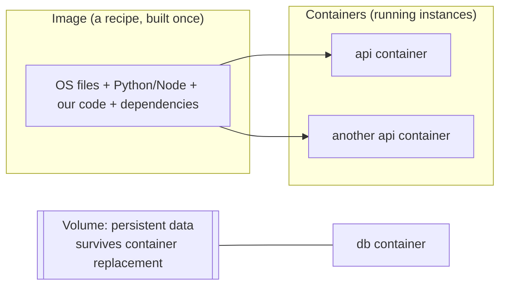
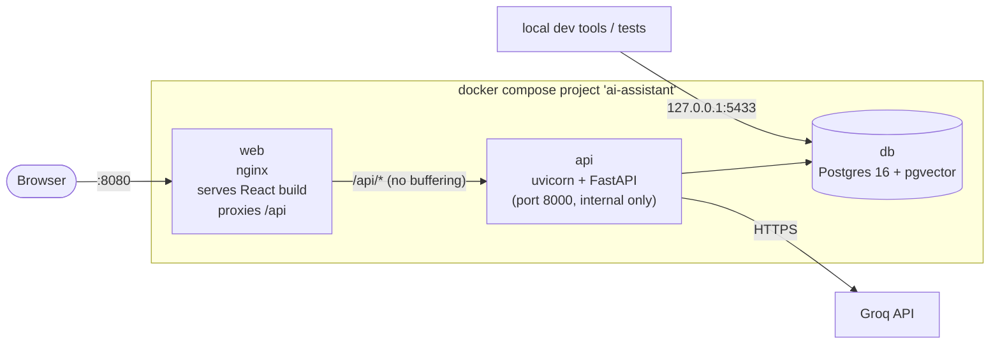
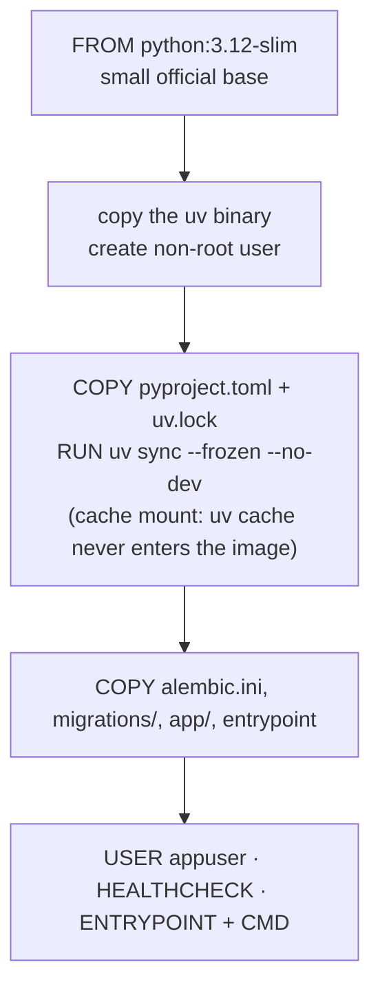
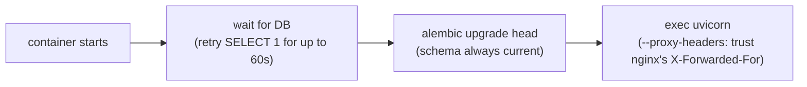
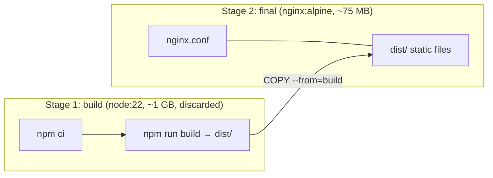
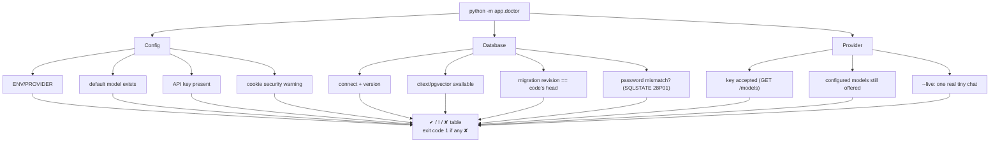
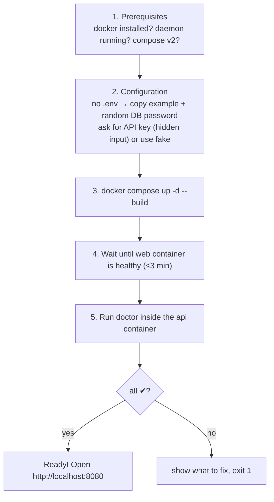
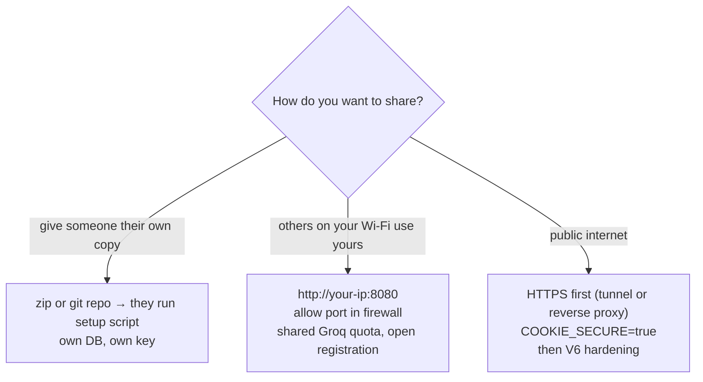

# 13 · Docker and operations

This chapter covers turning the code into something that **runs the same way on any machine with one command**, checks its own health, and can be shared.

## Containers in one picture

- An **image** is a read-only template, built from a `Dockerfile`.
- A **container** is a running instance of an image: isolated, disposable, replaceable.
- A **volume** is storage that outlives containers. Our database files live in the volume `pgdata`, so rebuilding or replacing containers never loses data. `docker compose down -v` deletes it.

## The full stack

Defined in [`docker-compose.yml`](../docker-compose.yml):

| Service | Exposed to | Health check | Starts after |
|---|---|---|---|
| `db` | `127.0.0.1:5433` only (your machine) | `pg_isready` | — |
| `api` | Only the other containers (`expose`, not `ports`) | `/health/live` | `db` is healthy |
| `web` | `0.0.0.0:8080` (your network) | fetches `/` | `api` is healthy |

- **`depends_on: condition: service_healthy`** gives a startup order based on real readiness, not just "the container started".
- **`restart: unless-stopped`** brings everything back whenever Docker starts. To start Docker itself when you sign in, see [`docs/sharing.md`](../docs/sharing.md).
- **Configuration:** `env_file: .env` supplies your settings, and `environment:` overrides the container-specific ones. Inside Docker the database is reached at `db:5432` (the service name acts as a hostname), not `127.0.0.1:5433`. A YAML anchor (`x-db-url`) builds that URL once.

## The backend image

[`backend/Dockerfile`](../backend/Dockerfile), layer by layer:

**Why this order?** Docker caches each layer and rebuilds only from the first changed one. Dependencies change rarely and code changes often, so copying the lockfile *before* the code means a code change doesn't reinstall every package.

**Two size and security lessons from building it** (609 MB → 375 MB):
- `chown -R` after copying files **duplicates every file into a new layer**. Instead, create the user first and avoid the chown entirely: the code stays owned by root and is read-only for the app user, which is also more secure.
- Package-manager caches must not be baked into the image. A build **cache mount** keeps them out.

**Non-root user:** if someone exploited the app, they wouldn't be root inside the container.

### The entrypoint: wait, migrate, start

[`docker-entrypoint.sh`](../backend/docker-entrypoint.sh):

`exec` makes uvicorn **replace** the shell process, so Docker's stop signal reaches the server directly and it can shut down gracefully. `stop_grace_period: 20s` gives in-flight replies time to finish and be saved.

`--forwarded-allow-ips *` trusts proxy headers from anyone. That's safe **only** because the api isn't reachable except through nginx. It gives rate limiting the real client IP.

## The web image: build once, serve with nginx

[`frontend/Dockerfile`](../frontend/Dockerfile) is a **multi-stage build**:

The final image contains only the static files and nginx. No Node, no `node_modules`, no source code.

What [`nginx.conf`](../frontend/nginx.conf) does:

| Location | Behaviour |
|---|---|
| `/api/` | Proxy to `api:8000`. **`proxy_buffering off`** (streaming), 300 s read timeout, forwards `Host` (for the CSRF check) and `X-Forwarded-For`, and creates an `X-Request-ID` |
| `/assets/` | Cache for a year. File names contain content hashes, so a new build means new names. |
| `/` | `try_files $uri /index.html`: any client route like `/c/123` serves the SPA, and React Router takes it from there |
| everywhere | Security headers (`X-Frame-Options`, `nosniff`…), gzip, a 1 MB body limit |

## The self-check: `app.doctor`

A running app can still be misconfigured: a wrong key, a missing migration, a deprecated model. The doctor checks the **real runtime configuration** from inside the container:

Code: [`backend/app/doctor.py`](../backend/app/doctor.py), with the three sections at [`check_config`](../backend/app/doctor.py#L63), [`check_database`](../backend/app/doctor.py#L103) and [`check_provider`](../backend/app/doctor.py#L176).

Each failure message says **how to fix it**, not just what is wrong. Example: diagnosing the password mismatch required walking the chain of wrapped exceptions to find PostgreSQL's error code `28P01`; the generic message "is the DB running?" would have misled the user.

The **exit code** (0 or 1) lets scripts and CI act on the result.

## Setup scripts: one command for anyone

[`scripts/setup.sh`](../scripts/setup.sh) (bash) and [`scripts/setup.ps1`](../scripts/setup.ps1) (Windows PowerShell) do the same steps:

- `--check` / `-Check` runs only steps 1, 4 and 5. It changes nothing, so it's safe to run anytime.
- `--fake` / `-Fake` sets things up without an API key.

Lessons baked into the scripts:
- **Random secrets per install:** each copy gets its own database password, generated, never a shared default.
- **Look containers up by service** (`docker compose ps -q web`), not by a hard-coded name, so a second copy under another project name works too.
- **PowerShell 5.1 quirk:** with `$ErrorActionPreference = "Stop"`, *any* text a native program writes to stderr (even a harmless Docker warning) becomes a fatal error. The script uses `Continue` and checks exit codes instead.

**Proof it works:** a fresh copy (cloned, and separately unzipped) with no `.env`, running under a different project name and ports, went from nothing to a passing self-check plus a working chat in one command.

## Sharing

Full guide: [`docs/sharing.md`](../docs/sharing.md). The shareable zip was made with `git archive`, which includes **only committed files**. That excludes `.env` by construction, which is safer than zipping the folder by hand.

## Everyday commands

| Task | Command |
|---|---|
| Status | `docker compose ps` |
| Logs | `docker compose logs -f api` |
| Health and self-check | `./scripts/setup.sh --check` |
| Update after code changes | `./scripts/setup.sh` (rebuild + migrate + check) |
| Backup | `docker compose exec -T db pg_dump -U assistant assistant > backup.sql` |
| Shell into the DB | `docker exec -it ai-assistant-db-1 psql -U assistant -d assistant` |

**Next:** [14 · Rebuild roadmap →](14-rebuild-roadmap.md)
