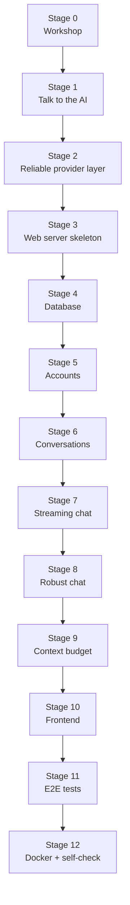

# 14 · Rebuild roadmap: build it yourself

This is your plan to rebuild the whole project from an empty folder. Each stage gives you:
- a **goal**
- the **concepts to learn first** (with chapter links)
- **what to build**, described rather than coded
- **where to look** in this codebase *after* you've tried yourself
- a **checkpoint** that proves the stage works

> **How to use the reference code:** try first, then compare. If you're stuck for more than about 30 minutes, read the referenced file, close it, and write your own version from memory. Copying teaches little; reconstructing teaches a lot.

---

## Stage 0: Workshop
**Learn:** [02](02-foundations-and-tooling.md)

**Build:**
- git init, `.gitignore` (secrets, venvs, `node_modules`) and `.gitattributes` (LF endings)
- install uv and Python 3.12; `uv init` a backend project
- a `docker-compose.yml` with only Postgres (pgvector image, port bound to 127.0.0.1)
- `.env.example` plus your own `.env`

**Reference:** [`docker-compose.yml`](../docker-compose.yml) (the `db` service only), [`infra/postgres/init/`](../infra/postgres/init/)

**✅ Checkpoint:** `docker compose up -d db` reports healthy, and you can connect with `psql`.

## Stage 1: Talk to the AI (probe)
**Learn:** [03](03-how-llm-apis-work.md), [04](04-streaming-and-sse.md)

**Build:** a standalone script, with HTTPX only, that:
1. lists models
2. sends one chat request
3. streams one reply, printing chunks as they arrive
4. prints the usage and rate-limit headers

Then try a wrong key and a huge prompt, and **write down what happens**.

**Reference:** [`backend/scripts/probe_groq.py`](../backend/scripts/probe_groq.py)

**✅ Checkpoint:** you have your own `providers.md`-style notes with measured limits, and you can explain why 413 must not be retried.

## Stage 2: Reliable provider layer
**Learn:** [05](05-provider-layer.md)

**Build:**
1. neutral types (request, events, errors)
2. a pure `RetryPolicy` class, unit-tested *first*
3. the Groq adapter: stream and complete, error mapping, retry loop, "never retry after output"
4. a fake provider with markers
5. a model allowlist file

**Reference:** [`app/providers/`](../backend/app/providers/), [`tests/unit/test_groq_provider.py`](../backend/tests/unit/test_groq_provider.py)

**✅ Checkpoint:** unit tests with respx cover 401, 413, 429 (short and long Retry-After), 503 ×3, timeout, a stream cut mid-way, and malformed JSON. A small terminal chat script works ([`scripts/chat_cli.py`](../backend/scripts/chat_cli.py) is the reference).

## Stage 3: Web server skeleton
**Learn:** [06](06-backend-skeleton.md)

**Build:**
- typed settings
- JSON logging with redaction
- request-ID middleware (pure ASGI)
- `AppError` plus the error envelope handlers
- an app factory with lifespan
- `/health/live`, `/health/ready` and `/api/models`

**Reference:** [`app/main.py`](../backend/app/main.py), [`app/core/`](../backend/app/core/)

**✅ Checkpoint:** every error, including 404 and 422, returns the envelope with a `request_id` that matches the `X-Request-ID` header.

## Stage 4: Database
**Learn:** [07](07-database.md)

**Build:**
- models for users, sessions, conversations, messages and `llm_calls`
- async engine and sessions
- Alembic with async `env.py`; autogenerate the first migration and **review it**: add the citext extension and the partial unique index by hand
- `alembic check`

**Reference:** [`app/db/`](../backend/app/db/), [`migrations/`](../backend/migrations/)

**✅ Checkpoint:** `\d messages` in psql shows all the constraints; `alembic check` reports no drift; `/health/ready` checks the DB.

## Stage 5: Accounts
**Learn:** [08](08-auth-and-security.md)

**Build:**
- argon2 hashing
- register, login, logout and me
- opaque session tokens stored as hashes
- an httpOnly, SameSite cookie
- a `current_user` dependency
- the Origin-check middleware
- a token-bucket rate limiter on login and register

**Reference:** [`app/auth/service.py`](../backend/app/auth/service.py), [`app/api/deps.py`](../backend/app/api/deps.py), [`app/core/security.py`](../backend/app/core/security.py), [`csrf.py`](../backend/app/core/csrf.py), [`ratelimit.py`](../backend/app/core/ratelimit.py)

**✅ Checkpoint:** integration tests show that wrong-password and unknown-email errors look identical, logout kills a copied token, a cross-origin POST gets 403, and the 6th login attempt gets 429.

## Stage 6: Conversations
**Learn:** [07](07-database.md#a-query-pattern-youll-see-everywhere)

**Build:**
- create, list, get, patch, soft-delete, and list messages
- *every* query filters by owner
- model settings validated against the registry

**Reference:** [`app/conversations/service.py`](../backend/app/conversations/service.py), [`app/api/conversations.py`](../backend/app/api/conversations.py)

**✅ Checkpoint:** an `alice`/`bob` test shows Bob gets 404 on every Alice endpoint, identical to a random id.

## Stage 7: Streaming chat (happy path)
**Learn:** [09](09-chat-pipeline.md) (first half), [04](04-streaming-and-sse.md)

**Build:** the two-phase design:
- **prepare:** validate, lock, save the user message plus a `streaming` placeholder, commit
- **generate:** stream events, then finalise in a fresh session

Also define the SSE event vocabulary.

**Reference:** [`app/chat/service.py`](../backend/app/chat/service.py) (`prepare_new_turn`, `generate`, `_finalise`), [`app/api/chat.py`](../backend/app/api/chat.py)

**✅ Checkpoint:** `curl -N` shows `user_message → assistant_started → delta… → usage → done`, and the DB holds both messages plus an `llm_calls` row.

## Stage 8: Robust chat
**Learn:** [09](09-chat-pipeline.md) (second half)

**Build:**
- the idempotency key
- the in-progress check plus the DB index, with `IntegrityError` turned into 409
- release of stale and abandoned streams
- error events with public messages
- partial vs failed outcomes
- the shielded `finally`
- the disconnect-aware SSE response
- retry in place
- the chat rate limit
- auto-title

**Reference:** the rest of `chat/service.py`, [`app/api/sse.py`](../backend/app/api/sse.py)

**✅ Checkpoint:** the integration tests in [`test_chat.py`](../backend/tests/integration/test_chat.py) pass *with your implementation*. Copy the test file into your project; it's a ready-made specification. Then kill curl mid-reply and confirm `cancelled` is saved.

## Stage 9: Context budget
**Learn:** [10](10-context-and-memory.md)

**Build:**
- a token estimator
- `compute_budget`
- `build_context` (newest-first, stop at the first misfit, no orphans, reject oversized messages)
- the per-request TPM guard

Calibrate the estimator against real usage. Optionally, background summaries.

**Reference:** [`app/conversations/context.py`](../backend/app/conversations/context.py), [`tokens.py`](../backend/app/conversations/tokens.py)

**✅ Checkpoint:** [`test_context.py`](../backend/tests/unit/test_context.py) passes; a long conversation with a budget of 300 never exceeds it.

## Stage 10: Frontend
**Learn:** [11](11-frontend.md)

**Build, in this order:**
1. Vite React-TS project, Tailwind, the dev proxy
2. a typed API client with `ApiError`
3. the `postSSE` reader (test it against your backend first!)
4. session hook, login/register pages, `RequireAuth`
5. sidebar with conversation queries
6. the `useConversationChat` state machine
7. the assistant-ui `ExternalStoreRuntime` wiring
8. Thread components (error plus Retry, Stop)
9. settings panel
10. mobile drawer

**Reference:** [`frontend/src/`](../frontend/src/)

**✅ Checkpoint:** a manual run-through: register, chat, Stop, Retry after `[fake:fail_once]`, reload, a second user is isolated, and it works on a phone-sized window.

## Stage 11: E2E tests
**Learn:** [12](12-testing.md)

**Build:**
- a Playwright config that starts the backend (fake provider, separate DB) and Vite on separate ports
- specs for each user journey
- condition-based waits

**Reference:** [`frontend/playwright.config.ts`](../frontend/playwright.config.ts), [`frontend/e2e/chat.spec.ts`](../frontend/e2e/chat.spec.ts)

**✅ Checkpoint:** the suite passes three times in a row (proving it's not flaky).

## Stage 12: Docker, self-check, setup
**Learn:** [13](13-docker-and-operations.md)

**Build:**
- the backend Dockerfile (layer order, non-root, cache mount) and an entrypoint that waits, migrates and execs
- the web multi-stage image and nginx config (no buffering, SPA fallback)
- the full compose file with health-based `depends_on`
- the doctor
- the setup scripts, with a `--check` mode

**Reference:** [`backend/Dockerfile`](../backend/Dockerfile), [`frontend/Dockerfile`](../frontend/Dockerfile), [`frontend/nginx.conf`](../frontend/nginx.conf), [`app/doctor.py`](../backend/app/doctor.py), [`scripts/`](../scripts/)

**✅ Checkpoint:** a fresh clone or zip with no `.env` reaches "Ready!" with one command, and replies still stream word by word through nginx.

---

## Practice exercises (beyond V1)

Ordered from easy to hard, each extending what you built:

1. **Dark-mode toggle** in the UI, persisted in `localStorage` (frontend only).
2. **Show token usage** under each reply. The `usage` SSE event already carries it.
3. **Pagination** for the conversation list. The backend currently caps it at 100.
4. **Edit an earlier message.** This forces you to design "branches" (why retry is latest-only today).
5. **Add a second provider** (for example Gemini) as a new adapter, plus a fallback when Groq returns 503. Remember: never fall back after output has been sent.
6. **Shared rate limits:** move the token buckets into Postgres, then decide whether Redis is justified (and record the decision!).
7. **Start V2:** document upload and retrieval with citations (see `docs/ROADMAP.md` §10–17). pgvector is already in the database image.

**Next:** [15 · Lessons learned →](15-lessons-learned.md)
