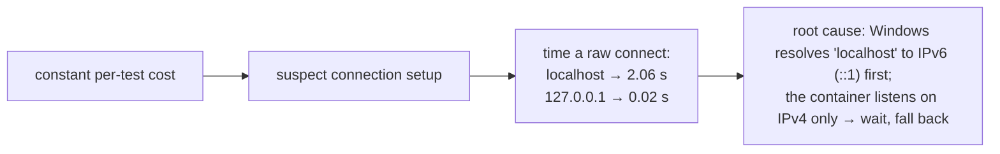
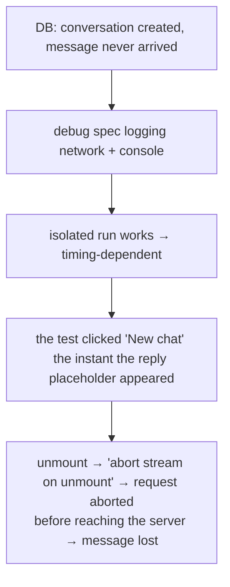
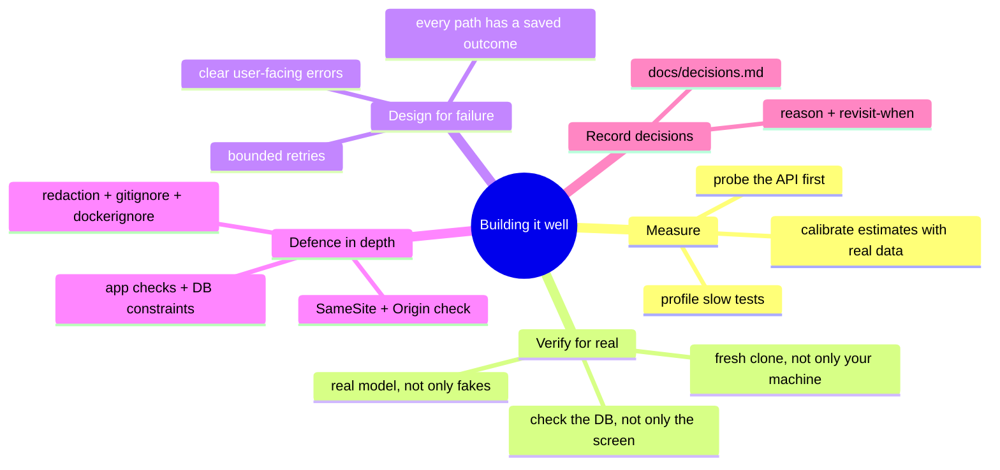

# 15 · Lessons learned (real problems, real diagnoses)

These problems actually happened while building this project. Each one follows the same pattern: **symptom → investigation → root cause → fix → general lesson**. The lessons transfer to any project.

---

## 1. The 2-second database connection

**Symptom:** the integration test suite took **109 s**. Profiling (`pytest --durations=8`) showed every test spent a constant ~4.4 s in *setup*.

**Investigation:**

**Fix:** use `127.0.0.1` in every database URL. The suite dropped to **12.6 s**, and real app requests got faster too.

**Lesson:** when time is *constant and suspiciously round*, it's usually a timeout or fallback, not slow code. Measure the smallest piece in isolation.

## 2. The 413 that retries could never fix

**Symptom (found by the probe):** an oversized request returned **HTTP 413 with a `retry-after` header**.

**Root cause:** the request exceeded the *per-minute* token limit. Waiting resets the minute, but the single request is still too big.

**Fix:** 413 is classified as non-retryable `request_too_large`, plus an app-side pre-check that rejects such requests before calling the API.

**Lesson:** don't trust headers blindly. A `retry-after` doesn't mean retrying can succeed. **Probe real behaviour before writing the adapter.**

## 3. The server that kept generating after the user left

**Symptom:** after Stop, the backend kept consuming Groq quota until the reply finished.

**Root cause:** Starlette's `StreamingResponse` (under ASGI spec 2.4) only notices a disconnect when its *next write fails*. While waiting on Groq nothing is written, so nothing is noticed.

**Fix:** a custom `SSEResponse` that listens for `http.disconnect` in a parallel task and cancels immediately ([chapter 09](09-chat-pipeline.md#cancellation-the-tricky-part)).

**Lesson:** read your framework's source when behaviour surprises you. It took one `inspect.getsource` call to find this.

## 4. The cancelled reply that stayed "streaming" forever

**Symptom (anticipated in the design):** on cancellation, saving the final status could itself be cancelled.

**Root cause:** in async frameworks (anyio), once a task is cancelled *every subsequent await* is also cancelled ("level-triggered" cancellation), including the database write in `finally`.

**Fix:** wrap the cleanup in `CancelScope(shield=True)`.

**Lesson:** cleanup code in async programs needs explicit protection from cancellation.

## 5. React StrictMode aborted a just-sent message

**Symptom (e2e):** in the rename test, the first conversation existed in the DB with **0 messages**, yet the UI had briefly shown a reply.

**Investigation:**

A first fix (deferring the abort to survive StrictMode's simulated unmount) wasn't enough. The real question was **should leaving a conversation cancel its reply at all?**

**Fix (a design change):** navigating away **doesn't** abort. The server finishes and saves the reply, and returning shows it (polling while the server still reports `streaming`). Only Stop cancels.

**Lesson:** a flaky test is often a real bug in disguise. Check the **database**, not just the screen. And sometimes the fix is a product decision, not a code tweak.

## 6. The title that didn't update

**Symptom (e2e):** the sidebar showed the auto-generated title but the header still said "New conversation".

**Root cause:** after streaming, only the *list* query was invalidated, not the single-conversation query the header reads.

**Fix:** invalidate both.

**Lesson:** with cached server state, every piece of UI reading a value needs its cache entry refreshed. List all the queries that display a field you change.

## 7. Sign-out that didn't redirect

**Symptom (e2e):** after clicking Sign out, the URL stayed on the chat page.

**Root cause:** `queryClient.clear()` removed the `me` query *and detached the component observing it*. Setting `me = null` afterwards created a new cache entry nobody was watching, so React never re-rendered the route guard.

**Fix:** set `me` to `null`, then remove every *other* query.

**Lesson:** "clear everything" is a sledgehammer. Know what your UI is subscribed to.

## 8. The race in the test, not the app

**Symptom:** the "message too long" test failed randomly: the notice never appeared and the text stayed in the composer.

**Root cause:** the test sent its second message while the first reply was still streaming, and the composer (correctly) ignores sends during a reply. The test's "wait for a reply" condition was satisfied instantly by the *empty placeholder*.

**Fix:** a `waitForReply` helper that waits for actual reply text *and* for the Stop button to disappear.

**Lesson:** in UI tests, wait for the **condition that actually matters**, not for something that merely looks similar.

## 9. Silently truncated answers

**Symptom (real Groq run):** a long answer ended mid-word: "…with the retaile".

**Root cause:** `max_tokens = 800` was reached. The provider signals this with `finish_reason: "length"`, and nobody was looking at it.

**Fix:** store `length_limit` on the message and show "This reply reached the maximum length…". Also add a **default system prompt** asking for concise answers.

**Lesson:** test with the real model, not only fakes. Fakes only do what you imagined.

## 10. The token estimate that was too optimistic

**Symptom:** estimated 39 tokens, actual 47.

**Root cause:** the per-message formatting overhead was underestimated.

**Fix:** overhead raised from 4 to 7, then re-checked (229 estimated vs 218 actual, now safely over).

**Lesson:** store estimates *next to* real values, so you can calibrate with data.

## 11. The summary that blocked the conversation

**Symptom (integration test):** with summarisation on, the next message was rejected.

**Root cause:** the summary grew so large that system prompt plus summary left no room for the new message, which triggered `message_too_long`.

**Fix:** cap the summary at a third of the budget.

**Lesson:** every input that can grow needs a ceiling, especially ones produced by the AI.

## 12. Smaller things worth remembering

| Problem | Lesson |
|---|---|
| Logger crashed under pytest ("I/O operation on closed file") because it held a reference to the original stdout | Resolve global resources lazily |
| `chown -R` in the Dockerfile doubled the image size (609 → 375 MB after fixing) | Every Dockerfile instruction is a layer; changing file metadata copies the files |
| PowerShell 5.1 treated a harmless Docker warning on stderr as fatal | Know your shell's error semantics; check exit codes explicitly |
| A test assumed the local dev password and would fail on fresh installs | Tests must not depend on one machine's configuration |
| The roadmap Markdown came from a converter that merged bullet lists into paragraphs | Inspect generated files; fix them with a script, and *diff* the result |
| A heredoc in a shell turned `\n` into a real newline inside Python source | When generating code through a shell, quoting bites. Write files directly. |
| The password-mismatch error was hidden three exceptions deep | Walk the exception chain and match stable error codes (SQLSTATE), not messages |

## The meta-lessons

**Next:** [Glossary →](glossary.md)
