# Learning guide: build this AI business assistant yourself

This folder teaches you how the project works, and why it is built this way, well enough that you could rebuild it from an empty folder.

**How it teaches:**
- It explains with **diagrams and plain language**, not by copying code.
- When an idea needs a code illustration, it uses a **small generic example that is not from this project**.
- When it talks about something this project does, it gives you a **pointer into the real code**, so you read the actual implementation yourself.

---

## How to read the pointers

Every reference looks like this: [`groq.py:80` `GroqProvider.stream`](../backend/app/providers/groq.py#L80)

- The link opens the file at that line (on GitHub, and in VS Code with Ctrl+Click).
- The function or class name is always included too. Line numbers drift as code changes; if a line doesn't match, search the file for the name.
- The references match commit `7a5d048` (end of V1).

## How to view the diagrams

The diagrams are written in **Mermaid**, a text format that renders as pictures.
- **GitHub** renders them automatically.
- **VS Code**: install the extension *"Markdown Preview Mermaid Support"*, open a chapter and press `Ctrl+Shift+V`.
- Anywhere else, paste a diagram block into https://mermaid.live.

---

## Chapters

| # | Chapter | You will understand |
|---|---|---|
| 01 | [The big picture](01-big-picture.md) | What the app is, its four parts, and the journey of one chat message |
| 02 | [Foundations and tooling](02-foundations-and-tooling.md) | Python and uv, Node and npm, Git, environment variables, how the repo is organised |
| 03 | [How LLM APIs work](03-how-llm-apis-work.md) | Messages, roles, tokens, temperature, rate limits, and checking a provider before trusting it |
| 04 | [Streaming and SSE](04-streaming-and-sse.md) | How words appear one by one: HTTP streaming, Server-Sent Events, the three hops |
| 05 | [The provider layer](05-provider-layer.md) | Adapters, error normalisation, retries with backoff and jitter, the fake provider |
| 06 | [Backend skeleton](06-backend-skeleton.md) | FastAPI, app factory, lifespan, dependency injection, middleware, errors, logging, config |
| 07 | [The database](07-database.md) | PostgreSQL, the schema, SQLAlchemy async, migrations, constraints that enforce rules |
| 08 | [Authentication and security](08-auth-and-security.md) | Password hashing, sessions and cookies, CSRF, ownership, rate limiting, secrets |
| 09 | [The chat pipeline](09-chat-pipeline.md) | **The heart of the app**: one message from click to saved reply, including failures |
| 10 | [Context and memory](10-context-and-memory.md) | Token budgets, trimming history, estimation, background summaries |
| 11 | [The frontend](11-frontend.md) | React, routing, TanStack Query, assistant-ui, the chat state machine, the SSE reader |
| 12 | [Testing](12-testing.md) | Unit, integration and end-to-end tests, mocks, fixtures, and the bugs tests caught |
| 13 | [Docker and operations](13-docker-and-operations.md) | Images, compose, nginx, health checks, the self-check, setup scripts, sharing |
| 14 | [Rebuild roadmap](14-rebuild-roadmap.md) | A step-by-step plan to rebuild it yourself, with checkpoints and exercises |
| 15 | [Lessons learned](15-lessons-learned.md) | Real problems hit while building it, and how each was diagnosed |
| — | [Glossary](glossary.md) | Every term used in this guide, in one place |

## Suggested reading order

```mermaid
flowchart LR
    A[01 Big picture] --> B[02 Tooling]
    B --> C[03 LLM APIs]
    C --> D[04 Streaming]
    D --> E[05 Provider layer]
    E --> F[06 Backend skeleton]
    F --> G[07 Database]
    G --> H[08 Auth & security]
    H --> I[09 Chat pipeline]
    I --> J[10 Context]
    J --> K[11 Frontend]
    K --> L[12 Testing]
    L --> M[13 Docker]
    M --> N[14 Rebuild it]
    N --> O[15 Lessons]
```

- **New to web development?** Read in order. Each chapter assumes only the ones before it.
- **In a hurry?** Read 01 and 09 first: the big picture plus the heart of the app. Then dip into the rest as needed.
- **Want to build it?** Read everything once, then follow [14](14-rebuild-roadmap.md) step by step. It tells you which chapter to re-read at each step.

## The project's own documents (read alongside)

| Document | What it is |
|---|---|
| [`docs/ROADMAP.md`](../docs/ROADMAP.md) | The product vision, V1 to V6: *what* we are building |
| [`docs/v1-architecture.md`](../docs/v1-architecture.md) | The V1 design plan written before coding |
| [`docs/decisions.md`](../docs/decisions.md) | Every important decision and its reason. **Very useful for learning "why".** |
| [`docs/providers.md`](../docs/providers.md) | What was *measured* about the Groq API |
| [`docs/test-matrix.md`](../docs/test-matrix.md) | Which test covers which scenario |
| [`docs/v1-acceptance.md`](../docs/v1-acceptance.md) | Proof that V1 meets its goals, and known limitations |
| [`docs/sharing.md`](../docs/sharing.md) | Operating and sharing the app |
